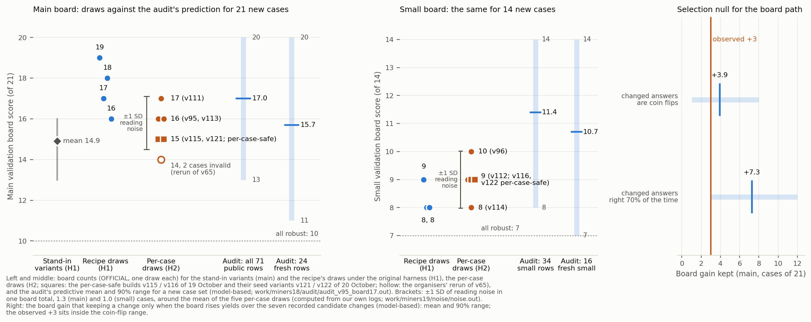
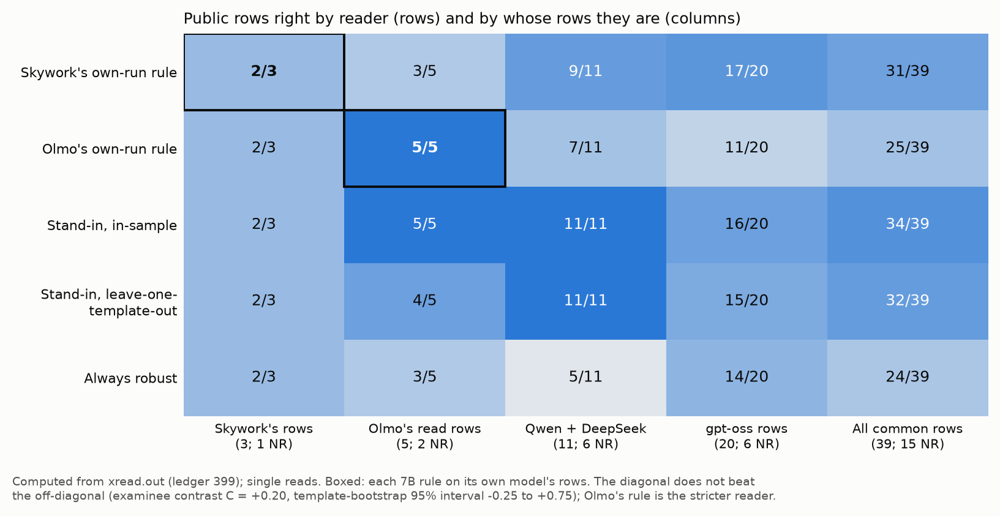

# Auditing a behavioural difficulty reading for generalisation: robustness prediction inside a fixed GPU budget, with pre-registered negative results

Jude Wallis (Independent researcher)

*Technical report, AIMO Interpretability Challenge 2026 (NeurIPS 2026, Codabench 16180), 20 October 2026 (UTC;
revised 22 October for instance-matched rows, Section 1). Numbers come from our research ledger (entry in brackets;
Section 10) or the output files named where used; hidden cases appear as counts only. Number labels (board, public rows,
mock, server, computed, model-based, local proxy, guess) are defined in Appendix F. Longer appendix parts are summarised
here; their full text, written before the revision, is in `report_supplement/`, one file per part.*

## Abstract

Inside a fixed GPU budget, we predict whether a configuration's accuracy on a math problem survives the organisers'
perturbations. In our fit, sampling noise explains about 3% of public non-robust labels; among solved problems the solve
rate says little about the label. Our entry reads behaviour: a gpt-oss-120b stand-in's answer agreement, whether the 7B
models' own attempts end inside a token cap, and a prior for gpt-oss high. The final uses new problems; we audit
generalisation. The only label-fitted part predates the board-tested changes of 5 to 11 October; leave-one-template-out
the entry gets 55 of 63 public and 17 of 22 fresh rows labelled on the text we read (matched rows; all rows: 60 of 71
and 18 of 24), and, of the 80 rows now labelled, 62.5 of 71 matched (68.75 of 80; eight reads pooled). Three routes
chosen later with board feedback decide 8 of 21 main cases; their board gain (+3) matches keep-if-better selection on
coin flips (+3.9) and 3 of 5 matched fresh-row errors sit on them, yet Skywork's route held up on 9 rows labelled after
its choice. Readings repeat exactly within a server state and resample across states (board SD about 1.3 cases), so
the board cannot rank our versions. The nominees scored 17 and 15 of 21 and 9 and 9 of 14 (one draw each). At the
boards' class and configuration mix we expect about 16 of 21 and 10 of 14 right on new problems (main 90% range 11 to
20). Of 88 negative results to 20 October, 70 failed a pre-set bar (2 were unclear), including white-box probes, token
confidence and fragility features: our difficulty readings sit near their ceiling, and what they miss is mostly the
problem's own fragility (15 of 16 problems labelled for several configurations carry one label; few problems).

## Contributions

1. **A generalisation audit of a contest entry** (Section 2; Appendix E.13): what was fitted to labels and when,
   out-of-sample and fresh-row accuracy, a selection null for the board path, an out-of-sample check of a board-chosen
   route, a label-free measurement of board noise and a frozen, hashed prediction for new problems; a generic script
   (`audit.py`; Appendix F.7) applies it to any entry with a labelled public bench.
2. **Where the label lives, and a behavioural difficulty reading**: a fitted label law under which the original's solve
   rate explains little of the label on the small track, and the transfer of each reading from public rows to two boards
   (Section 3).
3. **Deployment under a changed harness**: a per-case rebuild, time-guarded nominees mocked at the final's shape, a
   fault-injection pre-mortem, and decode-path fixes with in-run self-checks (Section 4).
4. **Negative results with their bars and significance cutoffs**: 70 pre-registered failures, including
   internal-versus-behavioural comparisons, a dose-response refutation for white-box probes, token confidence and
   fragility features (Section 5; Appendix D), a dormant-condition rating whose in-hour versions all failed, and a blind
   replication that undercut a contaminated bench (Section 6).

> **Key findings** (labels as in Appendix F; LOTO = leave-one-template-out)
> 1. Sampling noise explains about 3% of public non-robust labels. *Computed, public labels* [416].
> 2. Out of sample the entry gets 55 of 63 matched public rows and 17 of 22 matched fresh rows (all rows: 60 of 71
>    and 18 of 24); with 9 rows labelled later, 62.5 of 71 matched rows (all rows: 68.75 of 80 over eight reads).
>    *Measured, public LOTO; matched rows computed post hoc* [509, 618, 664].
> 3. Per-case rules scored 16 of 21 (main) and 10 of 14 (small); the nominees 17 and 15, and 9 and 9; one draw each.
>    *OFFICIAL board* [471, 560, 564, 575, 576].
> 4. Board-chosen routes gained +3, no more than keep-if-better selection on coin flips (+3.9; 90% range 1 to 8).
>    *OFFICIAL board; model-based null* [509].
> 5. Reading Skywork's cases with the stand-in gains in 4 of 5 public reads and loses in none (3 labelled rows, 2
>    change); on 9 rows labelled later the route gets 9 and 7 on two reads, the stand-in about 7.3. *Measured, public
>    rows* [509, 544, 618].
> 6. Readings repeat within a server state and resample across states: one board total varies by about 1.3 cases
>    (main), so the board cannot rank our versions. *Computed, own logs* [585].
> 7. White-box rating probes failed on the 28 templates (0.277; bar 0.60), and a prompt-state probe that tracks Qwen's
>    own solve rate (Spearman 0.803) loses 0.25 to 3.25 rows in every use: no White-Box claim. *Local proxy* [499,
>    652].
> 8. Written blind, STD's programs gained 0, 2 and 1 7B rows over the entry, not 3. *Measured, public rows* [521, 523,
>    528].
> 9. What the difficulty reading misses is mostly the problem's own fragility: by exact text, 15 of 16 problems labelled
>    for several configurations carry one label (few problems). *Computed, post hoc, public rows* [664].

## 1. Task, data and scoring

Write-ups are judged on generalisation of interpretability methods, actionable interpretability, negative results and
efficient methods (our Sections 2 and 3; 9; 5; 4.4 and 4.5). A White-Box Award added on 16 October needs an internal
signal whose effect an ablation shows to be substantial [498]; our entries use only behavioural signals (Section 5.2).

> **Two harnesses.** The evaluation harness changed on 15 October [464]. **H1** (until then): one 3,600 s process
> runs all seven calls (four on the small track), and calls can share problems and readings. **H2** (since; very
> likely the final): each case runs in its own process, one after another, sharing one 4,200 s job (4,020 s after a
> 180 s margin), and in-process state resets with every case. Board numbers before 15 October are H1.
>
> **Versions** (Appendix B). v95 / v96: scored per-case entries (main / small); v111 / v112: nominees, with the
> per-case-limit variants v115 / v116 (Section 4.5); v121 / v122: v115 / v116 with shifted seeds (Section 2.6);
> v113 / v114: public-default variants, not nominated.

- **Cases.** A case is a (problem, configuration) pair. The seven configurations are Qwen3.5-4B, Skywork-OR1-Math-7B,
  Olmo-3-7B-Think, DeepSeek-R1-0528-Qwen3-8B, and gpt-oss-120b at low, medium and high effort.
- **Label.** The organisers sample answers (temperature 1.0, up to 100,000 tokens) on the original and on perturbed
  texts grouped in families [39]. A case is robust iff the largest accuracy drop over families is at most 0.10,
  non-robust iff at least 0.25, and dropped in between [2]; it exists only if the configuration solves the original
  robustly.
- **Run.** One RTX PRO 6000 Blackwell GPU (about 95 GiB), no internet [178]. The final uses "a new, unpublished set of
  problems" [513]. The organisers' GitHub answers of 17 October: 30 to 50 questions at about 170 s per sample, several
  nominations allowed (issue #6), and any model may be used, on either track [181, 537].
- **Public data.** 82 rows over 28 templates; 71 labelled (52 robust, 19 non-robust) on 27 templates [3, 278, 382]. The
  **hard region** is the 17 labelled templates that a 2,000-token reader never finishes (37 rows, 19 robust) [267b,
  278]. **Fresh rows** are the 24 labelled rows on 12 AIME-2026 templates [446, 509]. The organisers added 12 Skywork
  rows on 15 October, 9 labelled (7 robust) [617].
- **Matched rows.** 8 of the 71 labelled rows (5 of them non-robust) and 9 of the 80 were labelled on another number
  instance than the template text every one of our readings used; `calib.json` flags this per row (`own_text`) [661,
  664]. Where a value has been recomputed on the 63 matched rows (71 of 80; computed, post hoc,
  `work/miners19/draft32/recompute_matched_v32.out`), we give it with the all-row value; other values on the 71 rows
  are all-row values, as are the full texts in `report_supplement/`.
- **Board.** Main: 21 cases, 10 robust [99]; small: 14 cases, 7 robust [270]. Score = 2 × (right robust calls) + 11 −
  (robust calls) on main [329], with 7 in place of 11 on small [327]. With per-call counts the score reveals
  hidden-label information by configuration [329b]; Section 4.1 and Appendix A.2 disclose our use.

## 2. Is the final entry fitted to the board? A generalisation audit

We audited how much of our main entry, v95, was chosen with board feedback (lane G, `work/miners17/laneG/AUDIT.md`; CPU
only) [505, 509]; `audit.py` recomputes Section 2.2's table and Section 2.3's selection null from two CSV files
(Appendix F.7).

### 2.1 What was fitted, and when

The only label-fitted part, the stand-in's logistic rule `decision.json` (10 coefficients; Appendix F.4), was fitted on
the 71 public rows on 5 October [113], after board uploads began (2 October) [20] but before the board-tested changes of
5 to 11 October, and is byte-identical from v7 to v95. Refitting it leave-one-template-out changes 1 of 71 answers
[509]; refitting it without the 8 mismatched rows (Section 1) changes no call on the dress read and 0 or 1 on each of
seven other reads (computed; Appendix E.13). Seven decisions were made or kept with board feedback; three of them,
chosen on 10 to 11 October, change answers:
gpt-oss high answered from its prior, Olmo's own run and Skywork's own run (Section 3.2). Together they decide 8 of 21
main and 6 of 14 small cases. About ten hand-set values (strength codes, caps, K, the own-run thresholds, the prior)
were chosen after seeing public rows and cannot be cross-validated (Appendix E.13).

### 2.2 Out-of-sample accuracy against the board

v95's rules on its server dress read [440], with `decision.json` refitted per held-out template (public rows;
template-bootstrap 95% intervals; board predictions are model-based, binomial at the board's class mix) [509];
matched rows (Section 1) computed post hoc [664]:

| Public rows, leave-one-template-out | Accuracy | Predicted board | Observed board |
|---|---|---|---|
| 63 matched rows (in-sample 56) | 55/63 = 0.873 [0.78, 0.94]; 0.811 at the board's mix | main 17.0 (90%: 13 to 20) | 16, 17 |
| 22 matched fresh rows | 17/22 = 0.773 [0.64, 0.90]; 0.763 at the board's mix | main 16.0 (11 to 20) | 16, 17 |
| 31 matched small-model rows | 27/31 = 0.871; 0.872 at the board's mix | small 12.2 (10 to 14) | 10 |
| All 71 (in-sample 61) | 60/71 = 0.845 [0.75, 0.92]; 0.807 at the board's mix | main 17.0 (90%: 13 to 20) | 16, 17; P(≤ 16) 0.39, P(≤ 17) 0.58 |
| 24 fresh (AIME-2026) rows | 18/24 = 0.750 [0.59, 0.90] | main 15.7 (11 to 20) | 16, 17; P(≤ 16) 0.58, P(≤ 17) 0.73 |
| 34 small-model rows | 0.817 at the board's mix | small 11.4 (8 to 14) | 10, P(≤ 10) 0.27 |

The four H1 draws on one fixed set of 21 cases (19, 17, 18, 16; SD 1.3) measure reading noise only; a new 21-case set
adds case sampling, a binomial SD of about 1.8 cases [509] (Figure 1). On small, public rows over-predict: 11.4 expected
against 8 to 10 in four draws. A pre-registered small-only refit of the stand-in's rule gained nothing (28 of 34 small
rows either way; bar +2), so the small-track gap is not a rule-fit problem [587].

**Nine rows labelled later** (pre-registered [618]): with them, v95's rules get 68.75 of 80 leave-one-template-out,
pooled over eight reads (0.859; balanced 0.826; always-robust 0.738), 65 to 71 per read.
On the 71 matched rows of these 80 (computed, post hoc): 62.5 of 71 (0.880; balanced 0.817; always-robust 0.789), 60 to
64 per read [664].



*Figure 1. Main (left) and small (middle) board draws (board) against the audit's predictive mean and 90% range
(model-based); squares: the per-case-safe v115, v116, v121 and v122; brackets: ±1 SD of reading noise (Section 2.6).
Right: the gain kept by keep-if-better selection over our seven recorded candidate changes (model-based) against the
observed +3. Script `figures/make_board_vs_audit_v29.py`.*

### 2.3 The board-chosen layer against a selection null

Our seven main-board candidate changes with recorded counts (5 to 11 October) changed 14 hidden answers, 6 of them right
(validation inference, Appendix A.2). Keeping a change only when the board rises yields an expected kept gain of +3.9
(90% range 1 to 8; P(≥ 3) = 0.72) if every changed answer is a coin flip, and +7.3 (3 to 12) if each is right 70% of the
time; we kept +3 (model-based) [509]. On public rows (five reads, leave-one-template-out) the high prior gains 1 to 2
rows per read, Olmo's own run 0 to 1, and Skywork's own run 0 to −2; as readers of the 34 small-model rows both 7B rules
trail the stand-in (Skywork 26, Olmo 24, stand-in 30) [509]. **The finishing layer adds no demonstrable accuracy: its
board gain equals the selection null, and the original public rows do not support Skywork's route.** Moving only the
Skywork cases to the stand-in gains in four of five reads and loses in none (312 against 307 of 355 rows; fresh rows 97
against 92 of 120; Appendix E.13) [509]. **Out of sample, the route held**: on the 9 new Skywork rows (7 robust),
labelled after it was chosen [617], the own run gets 9 on its design read and 7 on the dress read, the stand-in about
7.3 over eight reads; the pre-registered switch rule (stand-in ahead by 2) keeps the route [618]. The two own reads
differ on 3 of 12 rows, so the rows cannot separate the routes. Every nominee keeps every route. The board cannot settle
this: it chose the rule and cannot separate one-case differences (Section 2.6). Nor will the final: the public-default
variants (v113, v114 [544]) are not nominated.

### 2.4 Where the fresh-row errors are

Leave-one-template-out, v95 makes 11 errors (8 on matched rows); six fall on fresh rows (5 matched), and **three of
those six (Skywork T13 and T16, gpt-oss high T26) sit on board-chosen routes** [509, 664], all three on matched rows.
The stand-in alone, fitted only on public rows, is also weaker on fresh rows: 0.71 against 0.92 on the other 47 (partly
class mix) [509]. Fresh problems are also non-robust more often
(Appendix E.12) [446].

### 2.5 Expectation on new problems

At the announced 170 s per case [537], with the nominee v111 (v95's answers at server speed in the mock; Section 4.5),
we expect **about 16 of 21 main cases right on new problems (15.7 from fresh rows to 17.0 from all rows; 90% range 11 to
20)**, not the 19 of our best draw; on matched rows, 16.0 from fresh rows to 17.0 from all [664]. Other caveats: the
fresh rows are public rows the team saw while choosing the
hand-set values; leave-one-template-out refits only `decision.json`.

**Frozen prediction** (17 October, before the final; guess ranges) [543]. Accuracy on the final's new problems: main
v111 0.72 to 0.82 (central about 0.77) and small v112 0.62 to 0.76 (central about 0.69, about 10 of 14). Basis: Section
2.2's rates and the per-case boards' 16 of 21 and 10 of 14. Assumed: a roughly balanced class mix, a validation-like
configuration mix and a server no slower than 1.2x on Section 4.5's scale. The audit also predicts v113 at least level
with v111, and v114 with v112 [509, 544]. A pre-registered forecast, to be checked against the final.

Its ledger row (`work/miners18/FROZEN_PREDICTION_ledger543.txt`) has sha256
ffd7c3fcc370631dbc7501bd713444df47f067ede871a672c15ead8aa91a2ec6, computed on 18 October after the board runs below,
with no external timestamp [566].

**Decision rule** (18 October, after the board runs, before any final result) [568]: the forecast is confirmed on a
track if the final accuracy of v111 (main) or v112 (small), or of another nominee if only that one is scored, lies in
its range; below it, we over-estimated generalisation; above it, under-estimated. Outcome reports it either way.

**Coverage note** (20 October, before any final result; computed, normal approximation): at Section 2.6's 0.07 to 0.09
per run, the frozen ranges would contain the outcome with probability about 0.4 to 0.5 (main) and 0.55 to 0.7 (small)
even with exact centres; a miss by less than about 0.08 is weak evidence either way. The clause on v113 and v114 will
not be tested: they are not nominated.

**Against the board** (OFFICIAL board; single draws, not new problems): v111's 0.81 and v112's 0.64 lie inside the
frozen ranges, which used these boards: a consistency check, not a test. The public-default variants did not gain (v113
16, v114 8) [557, 558, 560, 564], as the selection null expects on main; v95's 16 and v115's and v121's 15 lie within
reading noise of v111's 17 (Section 2.6; Appendix E.17) [566, 608].

**Outcome** The final had not been scored when this report was submitted; we will report the evaluated entries' accuracy against these ranges, read with the coverage note, whichever way it falls.

### 2.6 How much a board score moves

Computed from our own logs; no hidden label is used [585]. Every seed is fixed, so within one server state a reading
repeats exactly (23 of 23 same-problem groups; v111 run twice made 21 of 21 identical calls). Across states every
stand-in reading is a fresh sample (17 of 17 problems); own runs and the prior never changed. A stand-in call flips
between states with probability about 0.26 (90% interval 0.14 to 0.45; 12 flips in 46 comparisons, 3 states; v115's 2
from the ledger, its log not archived). So one board total varies by about 1.3 cases (main) and 1.0 (small), matching
the four H1 draws' SD (Section 2.2), and v111's 17 against v115's 15 has probability 0.41 with no real difference
(model-based). On 30 to 50 new problems, reading noise and problem sampling give about 0.07 to 0.09 accuracy per run.
The seed variants v121 and v122 scored 15 and 9, their parents' totals [608], and three reads with different seeds in
one state differ by up to 5 of 71 rows (Section 5.1) [614, 618]. The board cannot rank v111, v113, v115 and v121, or
v96, v112, v114, v116 and v122.

## 3. A behavioural difficulty reading, and where the label lives

### 3.1 Where the label lives

The template explains about 70% of the variance of the drop (R² 0.80 in-sample, about 0.70 adjusted), the configuration
about 5% [9]. In our fit of the current label recipe [416], sampling noise explains about 3% of public non-robust
labels; LLM-rewrite families add only binomial noise; one hand-edited single-text family of about 10 answers breaks a
solving model with probability about 0.3; and the chance of a non-robust label is flat, 0.18 to 0.21, for solve rates
from 0.5 to 1.0 (Appendix E.10). T13 is the public example: every small model solves it and every one is labelled
non-robust [197, 266]. On hidden-like sets simulated from the fitted law (model-based), our readings beat an oracle that
knows each case's solve rate in 92 to 96 of 96 main scenarios but trail one that also knows how each variant family
breaks (Appendix E.10) [425, 432].

### 3.2 The readings in the entry

- **Stand-in** (Qwen, DeepSeek, gpt-oss low and medium cases): gpt-oss-120b at low effort, 4 to 32 attempts at a
  3,000-token cap, scored as the probability that two attempts that ended on their own agree; a Qwen3.5-4B quick finish
  (thinking off, 4 attempts at 2,000 tokens, 1 if any ends); a strength code; and the logistic rule [272b]. It scores
  0.845 / 0.844 (accuracy / balanced) leave-one-template-out on the 71 rows [272b] and 0.743 inside the hard region
  (0.649 to 0.865 over six reads) [278].
- **Own runs** (Skywork and Olmo cases): up to 3 attempts of the judged model at a cap of 9,000 (Skywork) or 10,000
  (Olmo) tokens; robust iff at least 1 (Skywork) or 2 (Olmo) of 3 attempts end on their own. The rules never check the
  answer, and their thresholds were chosen after seeing public rows [269, 339].
- **Prior** (gpt-oss high): always robust; 13 of 15 public rows are [336].

Public support for the own runs is thin: Skywork had 3 labelled rows when its route was chosen (12 since; Section 2.3)
and Olmo 9, and no own row supports calling a hard robust problem robust [339, 387] (Appendix E.1).

### 3.3 Does finishing measure work, and is the examinee special?

**Hypothesis: ending inside the cap measures the work a problem needs, not its solve rate.** AUC with robust rows
reading higher, template-cluster bootstrap 95% intervals, single reads, thresholds chosen on these rows (computed,
[387]):

| Reader, rows | Ends inside cap | Correct answer | Median length |
|---|---|---|---|
| Skywork, all 71 rows | 0.89 [0.77, 0.98] | 0.78 [0.60, 0.98] | 0.89 [0.74, 0.98] |
| Skywork, 37 hard rows | 0.83 [0.59, 0.98] | 0.72 [0.50, 0.97] | 0.77 [0.48, 0.97] |
| Olmo, 39 read rows | 0.71 [0.56, 0.89] | 0.71 [0.45, 0.93] | 0.71 [0.56, 0.89] |

Finishing ranks rows about as well as median length, a simple proxy for work. Outside work agrees: on AIME 1983-2024,
DeepSeek-R1-Distill-Qwen-7B's generations that finish inside the token budget are 90.3% accurate, those that exhaust it
6.6% (Oladri et al., 2026) [582]; there a layer-20 probe at token 150 predicts finishing only at AUC 0.608. Yet
Skywork's reading, applied to every main case, scored 12 of 21 on the board [299]: a public AUC is not board evidence.
Nor is the examinee shown to be special (Figure 2): each 7B rule reads the other model's rows as well as its own
(examinee contrast C = +0.20, template-bootstrap interval −0.25 to +0.75), and the differences track strictness (Olmo
calls 29 of 39 rows non-robust, Skywork 11; 15 are) [399] (Appendix E.11).



*Figure 2. Public rows right by reader and by whose rows they are (computed, `xread.out` [399]; single reads). Script
`figures/make_cross_reading.py`.*

### 3.4 What transferred

| Reading | Public rows (71) | Hard rows (37) | Fresh rows (24) | Board, H1 | Board, H2 |
|---|---|---|---|---|---|
| Stand-in alone, main | 0.845 LOTO [272b] | 0.743 [278] | 0.71 [509] | 13 to 16 of 21 | not run |
| Stand-in alone, small | 0.882 on 34 small rows [277] | — | — | 8 of 14 [284] | not run |
| Skywork's finishing, as reader of every case | 0.859; AUC 0.89 [269, 387] | 0.784; AUC 0.83 | — | 12 of 21 [299] | not run |
| v95's rules (main; H2: v95, v111, v115, v121) | 60/71 LOTO [509]; 68.75/80 pooled [618]; matched 55/63 and 62.5/71 [664] | 30/37 (matched 26/32) | 18/24 (matched 17/22) | 19, 17, 18, 16 [393] | 16, 17, 15, 15 [471, 564, 576, 608] |
| v96's rules (small) | 0.817 at the board's mix, 34 small rows [509] | — | 0.762 at the board's mix, 16 rows [509] | 9, 8, 8 [352, 366, 369] | 10, 9, 9, 9 (v96, v112, v116, v122) [471, 560, 575, 608] |
| Dormant-condition rating (Section 6) | 64/71 [453] | AUC 0.646 [457]; matched 0.711 (post hoc) [664] | 21/24 [455] | not run | not run |

The stand-in transferred at its hard-region level on main and not on small (Appendix E.8). Public accuracy overstates
hidden accuracy: the public rows hold many easy problems, the hidden set fewer by every observable we have. Reweighting
the public rows to the hidden calls' mean reading length lowers the stand-in's specificity from near 0.85 to 0.772, a
third of the gap to the board's 0.60 [401] (Appendix E.9).

## 4. Deployment inside the GPU budget

### 4.1 The original harness, in brief (H1)

Until 11 October the entry read every case through the stand-in; eleven such variants scored 13 to 16 of 21, mean 14.9
(Appendix A.1). From 10 October we iterated method variants against the board, guided by per-configuration counts and
the board arithmetic (Appendix A.2) [322, 329, 333, 338, 339, 348]: +High prior scored 16 [338], +Olmo own 17 [342] and
+Skywork own 19, twice [350, 352]; the small board gained nothing [352]. Fresh-seed reruns scored 18 and 16; the four
distinct draws average 17.5 (SD 1.3) [393, 427]. v83, planned for the assumed final scale [353, 354], was never scored
(Appendices B, C, E.3, E.4; `report_supplement/S41_original_harness_H1.md`).

### 4.2 The per-case harness (H2)

On 15 October a rerun of v65 that we had not made (most likely by the organisers) scored 14 of 21 against 19 on 11
October (case 20 timed out, case 21 was skipped); its log showed the per-case harness [464, 468]. v83 does not fit it
(mock: 6 of 21 main cases lost, 11 at 1.4x slower) [466]. v95 (main) and v96 (small) keep v83's decision rules and
change the work per case: gpt-oss high is answered at once from the prior; Skywork and Olmo run their own model first at
K 3, with the stand-in as fallback; other cases take the stand-in and the quick finish inside a 210 s target (own runs
400 s) [466]. On the server, v95 completed 21 of 21 cases in about 3,030 s and scored 16 of 21; v96 completed 14 of 14
in about 2,270 s and scored 10 of 14, our best small score [471, 476] (per-case costs: Appendix E.15).

### 4.3 The final's possible shapes

Before the organisers' answer, lane F mocked the shapes the final could take [510, 520]
(`report_supplement/S43_final_possible_shapes.md`). **v104** (main) and **v105** (small) skip Qwen's quick finish when
it cannot change the answer (answers identical in the mock) [510, 517].

### 4.4 Efficient decoding

Long-context decode steps cost the 7B models four to five times their short-context cost [357]: under an attention mask
`transformers` 5.13 copies K and V once per query head and copies the whole cache at every append; gpt-oss, under eager
attention, moves about 19 times the bytes it needs [183] (Appendix E.3). Our paths share one K/V read across a KV head's
query heads and write K and V in place into a pre-grown cache [360, 186]. Every run checks a path before use: greedy
agreement with the default path at least 0.99, a deliberately broken variant must fail the same check, and any error
other than out-of-memory falls back to the default path. On 16 October the check caught a failing compacting loop on the
server [566]. Pre-registered server benches:

| Model, shape | Default | Fast | Wall-time ratio (bar) | Check |
|---|---|---|---|---|
| Skywork-OR1-Math-7B, 12 rows to 7,000 tokens | 49 ms/step | 21 ms/step | 0.42 (≤ 0.67): 2.4x | agreement 1.000; sabotage failed [365] |
| Olmo-3-7B-Think, same | 76 ms/step | 37 ms/step | 0.48 (≤ 0.80): 2.1x | the same [365] |
| gpt-oss-120b, 112 rows × 3,072 context | 225.2 ms/step | 54.9 ms/step | 0.24 | argmax agreement 0.987 (two default runs: 0.977) [193] |
| gpt-oss-120b, 32 rows × 7,168 context | 145.4 ms/step | 39.1 ms/step | 0.27 | sabotage caught [193] |

Removing finished attempts from the batch and cache every 128 steps cut the stand-in from about 5.0 s to 2.0 to 2.4 s
per attempt [99]; together these paid for 32 stand-in attempts per problem on the board [282] (Appendix E.3).

### 4.5 Deployment robustness at the announced final (mock)

Lane F2 mocked the announced final [537] as one job of N × 170 s less the 180 s margin (164 to 166 s per case; the board
gives 191) for N = 30, 40 and 50, at server speed (calibrated to v95's run) and at 1.0x to 1.6x the mock's speed
(Appendix E.17) [538]. All mock, not board:

| Cases answered of 30/40/50 (validation mix) | Server | 1.0x | 1.2x | 1.4x | 1.6x |
|---|---|---|---|---|---|
| v95 (main) | all | all | 28/39/48 | 26/36/45 | 25/34/44 |
| v111 (main) | all | all | all | all | all |
| v96 (small) | 28/37/48 | 27/36/46 | 24/32/41 | 23/30/38 | 21/28/36 |
| v112 (small) | all | all | 28/36/47 | 27/35/45 | 25/33/43 |

**Nominees.** v111 is v95 plus two skips of Qwen's quick finish (when it cannot change the answer, and when the case
clock has cut the gpt-oss reading) and fixes F1 to F5; in the mock it gives v95's answers at server speed and 1.0x. v112
adds to v96 the same, a 165 s stand-in target and own runs stopped at 232 s (about 1.6 answer changes per 14;
model-based) [538].

**Pre-mortem.** Injecting 73 fault classes into v95, v96, v104 and v105 (mock; CPU checks of the real code) found three
bugs reachable on the contest server (Appendix E.17) [539]; fixes F1 to F5 change no answer without a fault and cut
invalid outcomes from 42 to 24 (main) and 17 to 5 (small) [540].

**Board runs** (OFFICIAL board, one draw each) [556-564]: v111 17 of 21, v113 16, v112 9 of 14 and v114 8 (v96: 10 of
the same 14), every case answered, at about 125 s per main and 135 s per small case against the final's 170 s (v96:
about 162 s).

**A per-case limit?** Whether "170 seconds per sample" is a job average or a per-case limit is unanswered (GitHub issue
#6, 19 October) [572]. Under such a limit v111's board run would lose 6 of 21 cases and v112's 3 of 14 [573]. v115 and
v116 stop own runs at 160 s and cap Olmo at 7,200 tokens (v115 also targets 165 s on stand-in cases): 15 of 21 and 9 of
14 on the board, no case over 148 s [575, 576]; v115's two calls that differ from v111's are reading noise (Section 2.6)
[576]. The shorter cap flips 21% of public Olmo problems robust at 10,000 tokens to non-robust, about one call per 40
small cases (model-based); a pre-registered threshold refit missed its bar (+4.8 points against +10) [584].

## 5. Negative results

Appendix D indexes 88 negative results from work to 20 October (ledger 619): **70 failed a bar written before their
data** (one judged on a model-based estimate), 2 were unclear, 13 were tested post hoc or without a bar, and 3 were
designed but not built or run.
*Pre-registered* means a bar written in our dated, author-controlled ledger before the data came back; none has an
external timestamp.

### 5.1 The twelve most informative

"Cutoff" is the smallest value each test could tell from chance (two-sided α = 0.05; computed; template clustering
ignored, so true cutoffs are higher; Appendix D).

| Test (pre-registered) | Bar | n | Measured | Cutoff (α = 0.05) |
|---|---|---|---|---|
| Probe on Qwen3.5-4B prompt states (server) [394] | balanced ≥ 0.80 | 71 rows | 0.669 (shuffled 0.525; stand-in 0.844) | balanced ≥ 0.63 |
| White-box rating probes W, W-sol, W-think (local proxy) [499, 506, 516]; W-oss on gpt-oss-120b (server) [555] | Spearman ≥ 0.60 | 28 templates | 0.277; 0.454 (95% interval 0.10 to 0.71); 0.304 (−0.08 to 0.61); 0.030 | ≥ 0.37 |
| In-hour gpt-oss raters, v90 / v94 / v97 (server) [461, 470, 491] | ≥ 0.50, then ≥ 0.60 | 16 to 28 templates | 0.472; high 0.637 on 20 parsed, policy 46/71; 0.49; −0.27 to 0.24 | ≥ 0.37 to 0.50 |
| Text-only distilled rater [477] | Spearman ≥ 0.60 | 28 templates | 0.279 | ≥ 0.37 |
| Kick-and-return, v89 (server) [463] | AUC ≥ 0.75 | 23 hard rows | 0.667; modal share 0.730 | AUC ≥ 0.75 |
| Route diversity (server) [420] | AUC ≥ 0.65 | 37 hard rows | 0.387 | AUC ≥ 0.69 |
| Organiser-style rewrites, gpt-oss low [302, 309] | drop ≥ 0.20 on non-robust rows | 7 rows | AUC 0.30 | none below 1.0 |
| Threshold at the stated base rate (board) [140] | gain ≥ +2 | 21 cases | 13 against 16 | ≥ 3 cases |
| Fresh-regime recalibration, lane R [515] | ≥ 20 of 24 fresh | 24 rows | 19 (base 18) | one row = 0.04 |
| STD with a 4B program writer (local proxy) [496] | ≥ 20 templates covered | 28 templates | 2 and 0 | — |
| Token confidence in place of agreement: top-half agreement, weighted agreement, mean lowest window, mean tail; lane CONF (server) [614] | +2 rows; second read +1 | 71 rows | −3, 0, −12, −9; second read −1, 0, −7, −3 | — |
| Prompt-state probe of Qwen's solve rate, lane WHITEBOX (local proxy; 21 October, after Appendix D's count) [652] | Spearman ≥ 0.40; at most 0.5 rows lost; ablation gain ≥ 2 rows | 28 templates; 80 rows | 0.803; each use loses 0.25 to 3.25 rows | — |

Many failures sit far below their bars (route diversity, v97's arms, W-oss). Others failed without excluding the bar:
W-sol's and W-think's 95% intervals include 0.60, and the rewrites (7 rows) and lane R (one row is 0.04 of accuracy)
could show little at their size.

**DeepConf-style token confidence did not help** (Fu et al., 2025; lane CONF; server) [583, 614]. A pre-registered
research run, v124r, recorded the confidence of every stand-in trace on the 28 templates at K 32 from raw logits,
through a recorder that only observes (byte-identical tokens with it on and off, values within 6e-6 of a recomputation,
sabotage caught, a reviewed fix before upload) [593, 597-600]. Under bars for the gain, fresh rows, a within-problem
shuffle and a second independent read, no candidate gained (table). Confidence ranks one problem's traces; across
problems it re-measures difficulty, less sharply than agreement. By-product: three complete reads with different seeds
in one server state scored 62, 57 and 62 of 71 with the rule refitted on each read's agreement (57, 59 and 62 with the
deployed fit's training reading) [614, 618].

### 5.2 Behavioural readings against internal probes

Our internal-probe baseline (pre-registered [388], read in [394]; Appendix E.6.3), an L2 logistic probe on the last
prompt-token hidden state, reached 0.669 balanced against the stand-in's 0.844.

**White-box rating probes** (local proxy: Qwen3.5-4B in 4-bit weights on a Mac) [498-500, 506, 507, 516]: a ridge probe
on three fixed layers, trained on the 325-problem pool rated by two blinded raters each and tested on the 28 templates,
with bars set before any state was computed, read the bare text (W), the text after the model's own 768-token solution
(W-sol) and after 2,048 thinking tokens (W-think). The pre-stated dose-response direction was refuted, all intervals
overlap (Section 5.1) and no probe's policy reached its bar [516]. An input-gradient probe (lane GRAD) also failed: AUC
0.250 against 0.75 [532, 533] (Appendix E.16). **We make no White-Box claim.** v102's gpt-oss-120b probe failed too
(Section 6.4) [555], as did token probabilities, which the contest's rules list among internal signals [580, 614]; a
claim would have needed a pass and a probe-off ablation on public rows and on at least two board draws per arm (Section
2.6).

**A prompt-state probe of difficulty** (lane WHITEBOX, 21 October; local proxy; bars written first) [652]. A probe on
Qwen3.5-4B's prompt states tracks Qwen's own solve rate on the 28 templates (Spearman 0.803; instrument bar at least
0.40, passed), but no use passes the bars that it lose at most 0.5 rows of 80 and that its ablation gain be at least 2
rows: as a tie-break it loses 3.25 rows, stacked 0.25, in place of the quick finish 0.38. Bound (post hoc): Qwen's
measured solve rate in the probe's place still loses 1.5 to 5.5 rows. The probe reads difficulty, which agreement
already reads better. Its pre-registration file (md5 1f603bda, asserted by the scorer) carries a header time of about
19:05 UTC but a file time of 18:25:40 UTC, before the state extraction (18:31:18 UTC) and the scores (18:39:05 UTC); we
read the header time as a clock-label slip (computed from file times). Lane W's pool-internal signal (nested Spearman
0.346; Appendix E.14) is withdrawn as evidence: it had no same-pipeline null, which fitted probes need [499, 644].

### 5.3 The common cause

Almost every refuted reading measures the difficulty of the original problem. In our label fit most non-robust labels
come from a single edited text that breaks a model which solves the original (Section 3.1), and our own variants never
reproduced T13's drop [266]. Difficulty readings, behavioural or internal, see the original; the label is made by a
text we cannot see.

**Six fragility vectors, none surviving** (CRP19; computed, and a local proxy) [609-613, 619]. Three cross-domain
features (accidental numeric identities, shallow wrong formulas that hit the answer, given numbers never reused in
gpt-oss low's traces) correlated +0.012, −0.099 and +0.008 with LATENT (Section 6.1; bar +0.20) [610]. A better answer
key buys little (post hoc): within configuration AUC 0.933 against the deployed reading's 0.914 on matched rows
(0.935 against 0.929 on all 71), and three zero-cost key proxies change no row at K 32 [611, 664]. Premise reliance
and instance-binding depth (a correct write-up's likelihood loss
when a condition is deleted or a number swapped; Qwen3.5-4B, 34 problems) correlated +0.150 and −0.038 (bar −0.30):
deleting the whole problem changes the write-up's log-likelihood by −0.315 nats per token in its first quarter and
−0.002 in the rest, so once a write-up restates the problem the scorer stops reading it [619]. Our difficulty readings
sit near their ceiling.

**What the difficulty reading misses is mostly the problem's own fragility** (computed, post hoc, public rows; Section
1) [664]. On the 63 matched rows the deployed agreement ranks rows at within-configuration AUC 0.914 (all 71 rows:
0.929); 30 of the 31 matched easy-template rows are robust, and on the 32 matched hard rows (13 non-robust) it is 0.821
(0.875), with 7 of 39 (7 of 56) same-configuration pairs misordered: four on gpt-oss high, two on low, one on Skywork.
80 pooled attempts give 0.897 (0.929) and their key-scored share 0.872 (0.911), inside the 0.821 to 0.936 of single
held reads. By exact problem text, 15 of the 16 problems labelled for several configurations carry one label (all 80
labelled rows, each under its own text), and 4 of the 5 with a non-robust label are non-robust for every configuration;
T10 is the exception (Section 6.2). An oracle calling a row non-robust when the other configurations' mean drop on the
same text is at least 0.175 would fix 6.4 of our calls per read and break 0.4 (matched rows, eight reads). These are few
problems, and the oracle uses labels; no in-budget reading of a problem's own fragility from the original passed all its
pre-set bars (Section 5.1).

**No refuted reading revives on the matched rows** (two pre-registered lanes; computed) [666, 671]. Lane RESCORE
rescored 50 problem-level readings and lane RESCORE2 25 more (14 with a verdict, 11 information lines), 75 in all, each
under family-wise control (Westfall-Young minP); none is revived. The one family-wise significant reading, offline STD
written blind by writer 1 (within-configuration AUC 0.971 on the matched hard rows, adjusted p 0.034), fails a
label-free part of its own bar and its leave-one-template-out gain bar, and cannot run in 170 s; writer 3 passes its
whole original bar on the matched rows but not the family-wise control [666].
Most factory-arm verdicts were already instance-matched, and targeted siblings were never run: untested, not refuted
[671].

## 6. Beyond difficulty: dormant conditions

### 6.1 A rating by blinded raters

A rater sees only a problem and its answer and scores **LATENT** from 0 to 3: how readily a re-instantiation of the
given numbers that keeps the deductive chain would make a condition bind that is dormant at the given numbers [442,
447]. A case is called non-robust iff the raters' mean is at least 1.5. Five independent Claude subagents rated the 28
public problems without labels or model names; three rated after bars and a frozen scorer were set [451, 452]. **The
rubric was not written blind**: the Claude agent that wrote it (lane A) had seen all 71 public labels [480] and about 12
of the 28 texts. On the 41 small-model and gpt-oss low rows the rating reached AUC 0.935, 37 right against the entry's
34; with the entry elsewhere, 64 of 71 and 21 of 24 fresh rows against 61 and 19 [453, 455, 457]. **The stand-in alone
also scores 64 of 71** (in-sample) and about 11 of the 12 7B rows, so most of the rating's public gain undoes the own
runs' public loss. By its pre-set bars the test failed (hard-row AUC 0.646 against 0.70; 6 of 7 low rows against 7 of
7), and the split by configuration was chosen post hoc on two raters [447, 453]. On the 32 matched hard rows
(Section 1) the five raters' pooled AUC is 0.711 and rater 1's, which the bar used, 0.674 (post hoc); the bar named the
37 rows, and on the matched rows the rating's leave-one-template-out gain still fails and its rise is within random-drop
noise [664, 666]. It is not difficulty: Spearman +0.08 with the stand-in's reading [447].

### 6.2 A worked example: T10's equivalent mutant

On two harsher expert-style rewrites of T10, gpt-oss low's wrong answers are exactly those of the correct method
without one check, a lower triangle bound (Appendix E.12) [446]; at the original numbers the check removes nothing (both
give 850), so the original cannot show the slip (an equivalent mutant). gpt-oss medium makes the same slip yet is
labelled robust, so our rewrites are harsher than the organisers' [318]. The bound is a dormant condition (T10's mean
rating 1.8). T10 is also the one problem labelled for several configurations whose label splits: low non-robust; high,
medium and Skywork robust (Section 5.3) [664]. For benchmark builders: an answer key at the given numbers cannot
separate a method from its equivalent mutant; only instances where the dormant condition binds can.

### 6.3 In-hour and computed versions

No model rated like this inside the hour in five pre-registered tries (Section 5.1) [461, 470, 477, 479, 491]. A
computed version, the **solution-transcription differential (STD)** [482], has gpt-oss low solve the problem and write a
direct search (`brute`) and a transcription of its own steps (`path`), runs both on 60 one-number re-instantiations, and
calls a 7B case non-robust iff they disagree on at least 5% of valid draws. Section 6.5 gives its post hoc bench and
blind replication [482]. The STD entries v107 and v108 were gated on the server read, which closed them (Section 6.4)
[531, 555].

### 6.4 The v102 server read: a pre-registered negative

v102 (Codabench 993976, research, 16 October [503]) read STD on the 28 public templates and a ridge probe on
gpt-oss-120b hidden states inside case 1, against bars, frozen scorers and outcome branches written before any data
[501, 502, 511] (Appendix E.14; server, public rows). STD arm A (gpt-oss low writes) covered 12 of 28 templates (bar 20)
at AUC 0.381 (bar 0.80): KILL. Arm B (medium writes) reached AUC 0.955, but two `brute` programs disagree at AUC 0.845
(sabotage bar ≤ 0.60): the signal is generic program disagreement, that is difficulty: KILL. The probe's W1 Spearman was
0.030 (bar 0.60): FAIL. By the pre-set branches, STD and the white-box route through gpt-oss states are closed. **No
white-box component and no STD reading is in any entry.**

### 6.5 A replication lesson: STD written blind

The STD bench's programs were written by a Claude agent (lane L) that had read the raters' notes [482]. Three
independent writers (Claude subagents) rewrote them under a pre-registration: public problems and answers only, programs
frozen, labels read after the frozen scorer's verdict (Appendix E.16; computed):

| Programs | 7B rows | All rows | Fresh | AUC | Scorer |
|---|---|---|---|---|---|
| After reading the notes [482, 489] | 12/12 | 64/71 | 21/24 | 0.905 | post hoc |
| Blind writers 1, 2, 3 [521, 523, 528] | 9, 11, 10 | 61, 63, 62 | 20, 21, 20 | 0.724, 0.900, 0.789 | FAIL each |
| Entry (v95) | 9 | 61 | 19 | — | — |

*Bars: 11/12, 63/71, 20/24, AUC ≥ 0.80, Spearman ≥ 0.40 (writer 2 fails on it alone). AUCs are the frozen scorer's (weak
and low rows); lane L's own bench gave the contaminated programs 1.000 [482].*

No blind writer reproduces 12 of 12: they gain 0, 2 and 1 rows over the entry, not 3. STD depends on how the writer
solves: number-specific shortcuts give its true positives (T11 to T14), coding choices and class-changing draws its
false alarms (T06, T07), and fully general solutions its misses (T10). **A reading computed through a solver's own steps
needs a pre-registered blind replication before anything is built on it.**[^t28]

[^t28]: All three blind writers' programs give 42 on T28, not the public answer 35: a possible key issue, not an
established error (Appendix E.16) [508, 521, 523, 528].

## 7. Related work

**The task.** The organisers' proposal (Štefánik et al., 2026) builds on LPDS (Mondorf et al., 2026), which finds each
model's hardest allowed instance of a template; there, a response's hidden-state distance from the model's own correct
responses predicts failure (AUC 0.74 to 0.80) where output perplexity does not (0.44 to 0.48) [254]. Our probes differ
in target and timing: they read the original prompt before any response, since an entry never sees the variants. The
organisers' uncertainty baseline follows Grünefeld et al. (2026); the slope of the judged model's own uncertainty early
in its trace carried no label signal for us (AUC 0.51 and 0.58) [296b].

**Robustness of math reasoning to perturbation.** GSM-Symbolic (Mirzadeh et al., 2025) and MATH-Perturb (Huang et al.,
2025a) show accuracy drops under re-instantiated or minimally edited problems; MATH-Perturb attributes hard-perturbation
failures to carrying the original method over, the mechanism of Section 6.2.

**Interpretability and generalisation.** Probing results need controls such as shuffled targets (Belinkov, 2022).
Whether interpretations predict behaviour on unseen data is asked by Li et al. (2025) and, for internal causal
mechanisms, by Huang et al. (2025b). Linear probes on the last prompt token that predict a model's own success before
generation (Lugoloobi et al., 2026) are the nearest prior work to our probe baseline. Our audit applies the same
question to a whole entry, and our probes add negative cases: rating probes that do not transfer to new templates,
and a difficulty probe that adds nothing to a behavioural reading (Section 5.2).

**Adaptive overfitting.** Section 2.3's selection null is a small case of adaptive data analysis, which the reusable
holdout (Dwork et al., 2015) and the Ladder leaderboard (Blum and Hardt, 2015) guard against. Studies of reused test
sets find little such overfitting in Kaggle competitions (Roelofs et al., 2019) and on new ImageNet test sets (Recht et
al., 2019); our board, 21 cases with per-call counts, is far smaller. The stand-in's agreement, the chance that two
sampled attempts give the same answer, reads the consistency that self-consistency votes on (Wang et al., 2023), which
DeepConf weights by token confidence (Fu et al., 2025; Section 5.1).

**Software testing.** STD is a metamorphic test (Chen et al., 2018) whose oracle is a brute-force program. T10's slip is
an equivalent mutant (Papadakis et al., 2015) and a case of coincidental correctness (Abou Assi et al., 2018).

## 8. Limitations

- **Instance mismatch**: 8 of the 71 labelled rows (9 of 80) were labelled on other numbers than the text we read;
  values not marked as matched are on all rows (Section 1) [661, 664].
- **Reading noise measured coarsely** (3 server states, 12 flips; Section 2.6); one H2 draw per file, without
  per-configuration counts; v115's log not archived [471, 556-564, 575, 576, 585].
- **Fresh rows are not unseen** (Section 2.5).
- **Thin, post hoc support for the own runs** (Sections 3.2 and 3.3) [269, 339]; one own read decided the 9 later
  Skywork rows [618].
- **Structural traps** no reading fixes: T05 (stand-in false alarms on Qwen and DeepSeek [192, 373]) and T13 (Skywork's
  own run calls it robust in every dress [373, 375, 379]).
- **The announced final is mocked, not run** (Section 4.5), on a virtual clock calibrated to one server run (v95's)
  [538]; whether the harness exposes a budget to the entry [464], or limits each case to 170 s [572], is unknown.
- **Local proxies**: the white-box probes and the 4B program writer used 4-bit weights on a Mac, one run each [496, 499,
  506, 516].
- **A rating rubric written with the labels seen** (Section 6.1) [447, 453].
- **The per-case-safe nominees' Olmo cap** biases calls toward non-robust (Section 4.5) [584].
- **No outside timestamp for pre-registration** (Section 5).
- **Raters and blind writers are Claude subagents**: independent in context, not in model (Sections 6.1, 6.5).

## 9. Lessons for practitioners

1. **Audit the board's influence before the final.** List every choice made with board feedback, refit the label-fitted
   parts leave-one-template-out and compare the board with a selection null (Section 2; `audit.py`). Ours moved our
   expectation from the best draw (19) to about 16 of 21.
2. **Measure board spread with fresh seeds, and check what drives it.** Same-seed reruns repeated 19 twice; fresh seeds
   gave 18 and 16 (SD 1.3 over four draws) [393]; ours resampled only across server states (Section 2.6).
3. **Require a second independent read and a bar written first.** Five single-read gains fell back on the next read (for
   example 0.90 to 0.79); verifying a +0.03 gain needs 410 to 1,028 independent labelled rows [195] (Appendix E.5; a
   blind rebuild, Section 6.5). Set bars above read-to-read noise: our recent +2-row bars sat below the 5-row spread of
   three reads [614, 616].
4. **Read the harness log of every scored run, and mock every shape the final could take.** The harness change of 15
   October would have cost our H1 nominee 6 of 21 cases (mock) [466] (Section 4.3); a fault-injection pre-mortem found
   three bugs reachable on the contest server (Section 4.5).
5. **Profile the decode step, and gate fast paths with an in-run check and a sabotage arm** (Section 4.4).
6. **Check that each labelled row's text is the text you read** (Section 1): 8 of our 71 labelled rows were not, and 5
   of them are non-robust [664].

## 10. Reproducibility

**Several submissions may be nominated per track** [537]; our nominees are in `work/dist/` [544], and v111, v112, v115,
v116, v121 and v122 can be rebuilt byte for byte from `release_public_v111/` (its README gives every command; md5s in
the table below; Appendix F.8) [549, 588]. **Training data**: `training/build_calib.py` rebuilds `calib.json` from the
organisers' public parquet, and `training/refit_low16.py` refits `decision.json` from it and our four public-template
server logs (`training/runs/`; Appendix F.8).

| Role | File | md5 | Board |
|---|---|---|---|
| Nominees, main; small (H2; Section 4.5) | `aimo_v111_main.zip` (`sub_v129m`); `aimo_v112_small.zip` (`sub_v130s`) | 9686c9cec06ec4dc40f9b728f7ef17db; 8b404890d71bc5483ccce18f88887636 [540] | 17 of 21 [562-564]; 9 of 14 [560] |
| Nominees, per-case-limit variants (Section 4.5) | `aimo_v115_main.zip` (`sub_v135m`); `aimo_v116_small.zip` (`sub_v136s`) | ad191e2e2262b0a918ec1aaf83bcf9c7; d3ada3a4b8ff05b5876582246008bbf9 [573] | 15 of 21 [576]; 9 of 14 [575] |
| Seed variants of v115 / v116 (Section 2.6) | `aimo_v121_main.zip` (`sub_v138m`); `aimo_v122_small.zip` (`sub_v139s`) | 22ced3169a4d73b5cfe9b7ceb0d815b6; 4de6852eee8d4c3e6ccb07576c422a31 [588] | 15 of 21; 9 of 14 [608] |
| Public defaults, not nominated (Section 2.3) | `aimo_v113_main.zip` (`sub_v131m`); `aimo_v114_small.zip` (`sub_v132s`) | 10c5050f2937ffaa613b9b8d34b215d1; 546e7fa7518cea17ab0df181dcae676a [544] | 16 of 21 [558]; 8 of 14 [557] |
| Scored per-case files (H2) | `aimo_v95_main.zip` (`sub_v114m`); `aimo_v96_small.zip` (`sub_v115s`) | 04460073a0d358ff3be70185906d8f05; 5d7ec8f10baf51e91d7a789cfdbb7e6c [469] | 16 of 21; 10 of 14 [471] |

**Evaluated entries**: Codabench 1003729 (v115, main) and 1003727 (v116, small) [574]; by the decision rule of Section
2.5 [568], the frozen ranges apply to them if they alone are scored. Their 7,200-token Olmo cap [573] costs about 0.6 to
0.9 main and 1.3 to 2.1 small cases per 40 new problems against v111 and v112 (model-based; a later estimate than
Section 4.5's) [654]. These ids may still change after the organisers' answers (v111 and v112 if 170 s is an average)
or a pending server timing test of an Olmo variant [657, 663].

**Nomination plan** (`NOMINATION_SHEET.md`, 20 October; the procedure is not yet published [571]): with several files
per track, v111 and v115 (main), v116 and v112 (small); with one, v115 and v116 unless the organisers say 170 s is an
average, then v111 and v112 [576, 585]. v113 and v114 are no longer planned. v121 and v122, our latest uploads, can
replace v115 and v116; if the best nominated entry counts, they add an independent read [608].

**v95 and v96** rebuild byte for byte, with `decision.json`, from `release_public_v95/` [476] (commands:
`report_supplement/F8_release_folder.md`). **Board scores** (each zip run unchanged in the organisers' harness, H2):
each case is call 1, with call 1's seeds (Appendix F.2), and the stand-in's K follows the speed measured in that
process. A rerun in the same server state reproduces every call; across states the stand-in's readings are fresh
samples, so v111 should give about 17 ± 1.3 of 21 and v112 about 9 ± 1.0 of 14 (Section 2.6) [585]. **Models loaded**:
gpt-oss-120b and Qwen3.5-4B, for Qwen, DeepSeek and gpt-oss low and medium cases and as the 7B fallback [466], which the
organisers allow [537].

**Licence**: code under the MIT License; report text under CC BY 4.0. **Repository**: https://github.com/EconLearn/aimo-interp-difficulty-vs-fragility; it will hold
`release_public_v111/` (the nominees) and `release_public_v95/` (v95 and v96). **Repository material** not reproduced
here: `report_supplement/` and `board_uploads_v29.csv` (every board upload). Our research ledger holds internal notes
and is not published as it stands; a redacted extract of the cited entries and Appendix F.7's scripts and outputs are
available on request.

## AI Use Statement

**Generative AI was used for most of this work.** We used Anthropic's Claude through Claude Code, a tool in which Claude
writes and runs code, reads and edits files and starts further Claude instances (subagents). The Claude models used were Claude Opus 5.5, Claude Opus 5 and Claude Fable 5.1. Claude was used for:

- **ideation**: research directions, hypotheses and the design of each pre-registered test (bars, controls, outcome
  branches);
- **coding**: the entries, decode paths, mocks, fault injection, the analysis and audit scripts, the release folders and
  the figure scripts; Claude also created and updated the public GitHub repository under the author's account, with the
  author's permission [632, 634];
- **research data**: Claude agents wrote the perturbed problem texts (1,976 texts; Appendix E.6.1) [302], the LATENT
  rating rubric (Section 6.1) [447, 480] and the STD bench's solution programs (Section 6.5) [482];
- **experiments and analysis**: local runs, the statistics and the research ledger; Claude also operated the
  competition site in the author's logged-in browser session, to read server logs and, from 5 October, to upload
  entries and research runs, among them v95 and v96 [469] and the evaluated v115 and v116 [574], under permissions the
  author gave in chat (at first for one night [125], later for a session or a named file [239, 503], and standing from
  18 October [556, 601]). One upload went up under a standing go-ahead before the author had answered a question about
  it [288], and one file was uploaded twice by mistake [295];
- **literature**: search and reading (statuses in the References);
- **writing**: this report, its supplement and its consistency checks; Claude instances also reviewed drafts and code.

Claude instances were also the five blinded raters of Section 6.1 and the three blind program writers of Section 6.5 (a
limitation; Section 8). No Claude model runs inside the entries, which use only the open models of Section 1.

**Tasks done without generative AI.** The author set the goals and limits of the work; gave the permissions for uploads and compute in chat, mostly as standing permissions; provided the competition, GitHub and other accounts; sent this project's messages to the organisers (Claude drafted some and sent none); made the final decisions, including which entries are evaluated with this report (Claude recommended them); and submits this report.

**Review and responsibility.** The author reviewed all AI-assisted work and takes full responsibility for the final content of this paper, including AI-assisted text, claims, code and other artefacts.

## References

Status: *read* (we read the paper), *abstract* (abstract page only), *listed* (details from the organisers' proposal's
bibliography; we did not open the work), *record* (authors and venue checked in the publisher's record; abstract not
seen).

- Abou Assi et al. (2018). arXiv 1808.09233. *Read* (by our mutation lane).
- Belinkov (2022). Computational Linguistics. *Listed*.
- Blum and Hardt (2015). ICML 2015. *Abstract*.
- Chen et al. (2018). ACM Computing Surveys. *Abstract*.
- Dwork et al. (2015). Science. *Abstract*.
- Fu, Wang, Tian and Zhao (2025). DeepConf. arXiv 2508.15260. *Abstract* [583].
- Grünefeld et al. (2026). arXiv 2605.07776. *Abstract*.
- Huang et al. (2025a). MATH-Perturb. ICML 2025; arXiv 2502.06453. *Abstract*.
- Huang et al. (2025b). ICML 2025. *Listed*.
- Li et al. (2025). arXiv 2507.06445. *Listed*.
- Lugoloobi et al. (2026). arXiv 2602.09924. *Read* (by our white-box lane).
- Mirzadeh et al. (2025). GSM-Symbolic. ICLR 2025. *Listed*.
- Mondorf, Bell, Dodge and Hupkes (2026). LPDS. arXiv 2605.15393. *Read*.
- Oladri, Jawahar and Mohamed (2026). arXiv 2607.21433. *Abstract* [582].
- Papadakis et al. (2015). ICSE 2015. *Record*.
- Recht et al. (2019). ICML 2019. *Abstract*.
- Roelofs et al. (2019). NeurIPS 2019. *Abstract*.
- Štefánik, Mondorf, Waldis et al. (2026). The organisers' proposal. arXiv 2607.13899. *Read*.
- Wang et al. (2023). ICLR 2023. *Abstract*.

## Appendix A. Every board-scored upload since 4 October

### A.1 Upload summary

**Kinds of rerun and research run:**

| Same seed, same day | Same seed, another day | Fresh seeds | Research run |
|---|---|---|---|
| the same file again: reproduced every count [345, 363] | the same file days later: one differed, 14 then 15 [386] (server states; Section 2.6) | every seed shifted: a new draw of the same rules, 18 and 16 [393] | public templates read for analysis; every hidden case answered "robust" by design |

Counts only. "Kind": **entry** = a candidate entry; **variant** = an entry-like method tried on the board; **rerun** = a
second upload of the same file; **research** = a research run whose hidden cases are all answered "robust" (main 10 of
21, small 7 of 14 by design; constant answers reveal nothing beyond these class counts [99, 270]) or answered by an
unchanged entry rule (marked); **not ours** = an upload on our account that we did not make. Uploads before 4 October
(ledger 1-63) are not listed, nor is one stuck upload on 10 October that never ran [313b]. Rows 1 to 78, 80 and 81 ran
under the original harness (H1) and rows 82 to 97 under the per-case harness (H2; Section 4.2) [464, 470, 471, 473,
503]; row 79 was cancelled. The CSV's harness column repeats this.

The full table, one row per upload with date, Codabench id, build, track, kind, change, harness, board score and ledger
entries, is repository material: `board_uploads_v29.csv` (97 rows, next to this report; rows 1 to 94 as in draft 28's
`board_uploads_v27.csv`). Summary (board counts; ranges over the rows of each kind):

| Track and harness | Entries | Variants | Reruns | Research | Not ours |
|---|---|---|---|---|---|
| Main, H1 | 10 rows, 14 to 19 | 10 rows, 11 to 16 | 6 rows, 13 to 19 | 20 rows, 10 by design (2 not recorded) | — |
| Main, H2 | 5 rows (v95, v113, v111, v115, v121), 16, 16, not scored (row 91), 15, 15 | — | 1 row (92, v111), 17 | 4 rows: 1 of 21 each (research in case 1; row 87 read in [555]), and row 95 (v124r) 0.33 with 4 cases invalid by design [607] | 1 row (82), 14 |
| Small, H1 | 11 rows, 5 to 9 | 5 rows, 7 to 9 | — | 18 rows, 7 by design or 8 with an unchanged entry rule | 1 row (79), cancelled |
| Small, H2 | 5 rows (v96, v112, v114, v116, v122), 10, 9, 8, 9 and 9 | — | — | — | — |

Rows 58 and 59: the ledger records the research outcome but not the board score; both are all-robust research runs (7 of
14 by design). Totals of our own uploads: main 56 (32 entries, variants or reruns, all scored but row 91; 24 research);
small 39 (21 entries or variants; 18 research, 5 of them with hidden cases answered by an unchanged entry rule); plus
rows 79 and 82, which we did not make. After row 94 the site counted 100 of the 300 uploads allowed [574], and 103 after
row 97 [601] (the running count: `report_supplement/A1_leaderboard_listing.md`, addendum of 20 October).

**Leaderboard listing.** When v95 and v96 were scored, the board's top scores under the per-case harness were 0.71 on
main and 1.00, 0.86 and 0.79 on small [467, 471]; the listings of 16 and 17 October [486, 497, 519] are in
`report_supplement/A1_leaderboard_listing.md`. At 11:32 UTC on 20 October the small board's top scores were 1.00 (two
teams), 0.93 (two) and 0.86 (two), above our best, 0.71 (v96); on main one team was at 1.00 and one level with our 0.81
[569, 570, 577, 598, 615].

**The stand-in baseline** (Sections 3.2 and 4.1, Figure 1) is rows 1, 2, 7, 8, 11, 19, 20, 35, 38, 51 and 53 [67, 85,
138, 140, 153, 200, 203, 282, 290, 330, 334]: 15, 16, 16, 13, 15, 15, 14, 16, 15, 14 and 15, range 13 to 16, mean 14.9
(computed). Among them are five variants of decision rule and reading, 16, 15, 14, 16 and 15
[290], a prior-matched threshold, 13 [140], and a longer-cap re-read of low cases, 14 [330]. Row 33, which answered
template cases from public partner labels instead of the reading, scored 11 and is not counted.

### A.2 Own-run answer changes (validation-set inference; H1)

**How board counts guided the order of changes** (Section 4.1). From 10 October we iterated genuine method variants
against the board, which the contest site invites ("Iterate on the leaderboard until the final deadline"), with a
public-row reason written before each upload, no constant answers per configuration, no per-case probes, and the nominee
chosen separately [322, 333]. Per-configuration counts with the board arithmetic located a run's errors by configuration
before the next change was chosen [329, 338, 339, 348]. The order, and when to stop, used validation-set information.
Appendix A.1 lists all 78 board uploads from 4 to 14 October (86 of the 300 allowed were used [436]), the nine from 15
to 16 October, two of them not made by us [473, 503], the five of 18 October [556-564], the two of 19 October [575, 576]
and the three of 20 October [601, 607, 608]. Right / wrong deductions from the board arithmetic are validation-set
inference.

**Worked example of the board arithmetic**, the +High prior run [338]: 11 robust
calls and a score of 16 give 16 = 2 × right + 11 − 11, so 8 were right and 3 wrong, 10 − 8 = 2 robust cases were missed,
and 3 + 2 = 5 errors leave 21 − 5 = 16.

This tally uses the board arithmetic and per-call counts. It infers hidden-label information at the level of counts per
change, and is shown here only to size the evidence.

| Board | Change | Answers changed | Right | Wrong | Basis | Ledger |
|---|---|---|---|---|---|---|
| main | +Olmo own against +High prior | 1 | 1 | 0 | previous stage's run: same seeds, identical counts in every other configuration | [342] |
| main | +Skywork own against +Olmo own | 2 | 2 | 0 | as above | [350] |
| small | Olmo own run against Skywork rule on all cases | 2 | 1 | 1 | previous variant's run | [341] |
| small | small recipe (Skywork 2 + Olmo 1 changes against the stand-in in the same run) | 3 | not determinable | not determinable | the stand-in's in-run score is not observed | [359] |

- Main board: 3 of 3 right; one-sided exact sign test p = 0.125.
- Both boards, where determinable: 4 of 5 right; p = 0.19 (computed: 6 / 32).
- **Both p-values are best cases.** The coin-flip null assumes each change had even odds of being right without label
  information. These changes were aimed using board counts: per-configuration counts had located the run's errors before
  Olmo's and Skywork's own runs were chosen [338, 339, 348] (Section 4.1). The only untargeted transfer, the same recipe
  moved unchanged to the small board, gave no gain (9, level) [352].
- The changes compare the own run with the gpt-oss stand-in. The one board comparison with the other 7B model is the
  small-board row above (Olmo's own run against Skywork's reading: 1 right, 1 wrong) [341]; Section 3.3.
- Caveat: the right / wrong split uses the previous stage's run as the baseline, not same-run arithmetic. It assumes the
  other readings repeated, which held in the per-configuration counts but which [329b] warns against in general.
- **A selection model of the board.** A binomial model fits 0.825 per upload (90% interval 0.725 to 0.900) to the
  recipe's four distinct draws on the same 21 cases [422]; treating the draws as independent, the interval understates
  the uncertainty for new cases, and our best draw, 19, also contains ordinary best-of-n luck.

*Full text, with the fresh-seed reruns' per-call counts, the recipe's draws, the medium draw and Skywork's reading of
every main case: `report_supplement/A2_own_run_answer_changes.md`.*

## Appendix B. Stages, versions and research reads

**Board path by stage** (main board; H1 unless marked; Section 4.1):

| Stage | Change | Main board | Ledger |
|---|---|---|---|
| Stand-in | one reading for all configurations | 13 to 16 (eleven runs, mean 14.9) | Appendix A.1 |
| +High prior | gpt-oss high answered from its public prior | 16 | [338] |
| +Olmo own | Olmo's own run on Olmo cases | 17 (same-seed rerun 17) | [342, 345] |
| +Skywork own | Skywork's own run on Skywork cases | 19 (same-seed rerun 19) | [350, 352] |
| +Coverage | coverage-first planning (Appendix E.4); same readings at board scale | 19 (same draw as +Skywork own [363]) | [362] |
| +Fast 7B | fast 7B decode path; same seeds | 17, same per-configuration counts as +Coverage | [369] |
| +Fast 7B, fresh seeds | every seed shifted by 7777 / by 424242 | 18 / 16 | [384, 385, 393] |
| **H2:** +Skywork own, rerun not by us | v65 under the per-case harness | 14, with 2 of 21 cases invalid (case 20 timed out, case 21 skipped) | [464, 468] |
| **H2:** per-case rebuild (v95) | v83's decision rules, one process per case (Section 4.2) | 16, every case complete | [466, 471] |
| **H2:** nominee (v111) | v95 + time guards and fixes F1 to F5 (Section 4.5) | 17, every case complete | [562-564] |

The later H1 stages are not scored. Under the per-case harness the same rules scored 14 in the organisers' rerun of
+Skywork own, with 2 cases invalid (so 14 right of the 19 cases it answered), 16 for v95 and 17 for v111, against H1
draws of 16 to 19 [464, 471, 564]; the rerun ran a design that did not fit the harness.

**Versions** (entries, candidates, insurance builds and the v102 research read; Section 10 names the nominees):

| Name in the text | Version | Bundle | Zip md5 | Board |
|---|---|---|---|---|
| Stand-in (nominated until 11 Oct) | v22 | `sub_v28m` | 8462d4b2cb2df5f6a631964f5e72cd4c | 14; cross-day copy 15 |
| +High prior | v60 | `sub_v75m` | 769f30e23a9045a196b3fb30e0bc70de | 16 |
| +Olmo own | v62 (rerun v62r) | `sub_v77m` | 2d9fbbbf361393eb65ca08e6f9371572 | 17, 17 |
| +Skywork own | v65 (rerun v65r) | `sub_v80m` | 24767cda3c4356e8b94bd98afe10de3c | 19, 19 |
| +Coverage | v67 | `sub_v82m` | b8c88f74bcb32aa1a226540650b31a43 [355] | 19 |
| +Fast 7B | v70 | `sub_v86m` | 9790692eb26fa78f09843b8f101c7fac [368] | 17 |
| +Fast 7B, fresh seeds 1 and 2 | v77, v78 | `sub_v95m`, `sub_v96m` | 0c2c3090..., 7004fc04... [384] | 18, 16 [393] |
| +Skywork K 3 (main candidate until v80; now second fallback) | v74 | `sub_v92m` | e8531c64821ed02e48cc5388ae08f51b | not scored |
| +Stand-in depth (main candidate until v83; now first fallback) = v74 + `future_new_factor` 0.25 | v80 | `sub_v98m` | 72d69c2c3874bfba2a05edd4ccb6e580 [395] | not scored; dress passed [404] |
| **+First-call cap (main nominee under the original harness)** = v80 + `first_call_K_max` 16 when call 1 has ≥ 10 problems (`first_call_cap_min_problems` 10) | v83 | `sub_v101m` | f93ef76c44d0733b22b5282e4c9b3e6a [406] | not scored on the board; its own dress rehearsal (Codabench 987666): 61/71 labelled public rows, end 2,916 s, every own case read [440] |
| **Small nominee under the original harness (+First-call cap + small marker)** | v84 | `sub_v102s` | 92d6ffe89dd487f0fe7914c253f3852d [406] | not scored |
| **Per-case entry, main (scored)** = v83's rules, one process per case (Section 4.2) | v95 | `sub_v114m` | 04460073a0d358ff3be70185906d8f05 [469] | 16 (per-case harness) [471] |
| **Per-case entry, small (scored)** = the same + small marker | v96 | `sub_v115s` | 5d7ec8f10baf51e91d7a789cfdbb7e6c [469] | 10 of 14 (per-case harness) [471] |
| STD + white-box probe research read (Section 6.4) | v102 | `sub_v121r` | d8ff5e27a4ee7ce65e230a811313c28c [502] | Codabench 993976; STD and the probe fail (Section 6.4) [503, 518, 555] |
| Answer-identical faster v95 (Section 4.3) | v104 | `sub_v123m` | 8cdf9cdc8a93c4a71780c08795f7ee06 [510] | not scored [510] |
| Answer-identical faster v96 (Section 4.3) | v105 | `sub_v124s` | 0b9e1896392dd82559ac75815ea8e2eb [517] | not scored [517] |
| Slow-server guards (Section 4.5; Appendix E.17) | v109; v110 | `sub_v127m`; `sub_v128s` | 47150657b57230eec4c5b4348fd37419; 69709983172fa376b171c6621bcc936f [538] | not scored |
| **Nominees for the announced final** (Section 4.5) = v109 / v110 + fixes F1 to F5 | v111; v112 | `sub_v129m`; `sub_v130s` | 9686c9cec06ec4dc40f9b728f7ef17db; 8b404890d71bc5483ccce18f88887636 [540] | 17 of 21 [564]; 9 of 14 [560] |
| **Public-default variants** (second nominees on 18 October; Section 4.5) = v111 / v112 with Skywork's cases read by the stand-in | v113; v114 | `sub_v131m`; `sub_v132s` | 10c5050f2937ffaa613b9b8d34b215d1; 546e7fa7518cea17ab0df181dcae676a [544] | 16 of 21 [558]; 8 of 14 [557] |
| **Per-case-limit variants** (Section 4.5) = v111 / v112 with every case under 170 s | v115; v116 | `sub_v135m`; `sub_v136s` | ad191e2e2262b0a918ec1aaf83bcf9c7; d3ada3a4b8ff05b5876582246008bbf9 [573] | 15 of 21 [576]; 9 of 14 [575] |
| **Seed variants** (Section 2.6) = v115 / v116 with every seed shifted by 271828 | v121; v122 | `sub_v138m`; `sub_v139s` | 22ced3169a4d73b5cfe9b7ceb0d815b6; 4de6852eee8d4c3e6ccb07576c422a31 [588] | 15 of 21; 9 of 14 [608] |
| Token-confidence research read (Section 5.1) = v115's stand-in path with a logits recorder | v124r | `sub_v141r` | 466ee4ed18135f602e30b335bea1453f [599] | Codabench 1004374; three complete reads and a partial one [607, 614] |
| STD entry candidates gated on v102 (Section 6.3) = v100 / v101 + v104's skip of a moot quick finish; answers identical on 455 mock case runs | v107; v108 | `sub_v125m`; `sub_v126s` | c7234444740fc0cc96cc15fd4782cc60; 5838d79213c98684595a6ec2cb69d30d [531] | not scored; gated on v102, which closed them [494, 511, 531, 555] |
| Insurance under the original harness, main: strict compliance (only the judged model loaded; DeepSeek from its public prior) | v85 | `sub_v103m` | e84f193b7df1e4a49c9e88d98bd24386 [409] | 15 (H1) [419] |
| Insurance under the original harness, small: strict compliance | v86 | `sub_v104s` | 0e6c5e085af86357b12c8fcab8c8957f [409] | 8 (H1) [419] |

*Full text, with the order of stages and fallbacks, the small-track fallbacks, the dress-rehearsal and research bundles
(v33b to v103) and the file-level differences between versions:
`report_supplement/B_stages_versions_research_reads.md`.*

## Appendix C. Adoption decisions and their bars

One row per decision; the full table gives each bar as written and every measured value.

| Decision | Bar before the data | Key result | Outcome |
|---|---|---|---|
| fast 7B decode path [361, 365] | yes | time ratio 0.42 and 0.48 (bars 0.67 and 0.80); checks passed | adopted |
| +Coverage at board scale (H1) [354, 362] | yes | 19, identical counts | adopted |
| +Fast 7B at board scale (H1) [368, 369] | yes | 17 with identical per-configuration counts | +Coverage kept until the dress rehearsal |
| +Fast 7B replaces +Coverage (H1) [370, 375] | yes | dress 2,671 s; 60 against 60 of 71 | adopted |
| +Skywork K 3 replaces +Fast 7B (H1) [376, 379, 387] | yes | dress failed only the Skywork-row condition (T16 0 of 3) | rejected by the pre-set rule; **adopted post hoc** (Appendix E.4) |
| medium own agreement [372, 373] | yes | stand-in 14 of 15 (bar: a gain of 2 of 15) | rejected |
| DeepSeek own run [346, 348] | yes | 4 of 6 (bar 5) | rejected |
| fresh-seed reruns [384, 393] | none: a measurement | 18 and 16 | never nominated |
| +Stand-in depth replaces +Skywork K 3 (H1) [395, 396, 404] | yes | first-call K 16; 3,034 s; 59 of 71 | **adopted** |
| +First-call cap replaces +Stand-in depth (H1) [406] | none: a guard after a mock comparison | 0 invalid in 39 mock shapes per track | **adopted** (v83) |
| per-case rebuild (v95 / v96) replaces v83 / v84 (H2) [464, 466, 471] | none | board 16 of 21 and 10 of 14, every case complete | **adopted** |
| change v95's board-chosen parts (audit) [509] | none: an audit | swap worth about 0 ± 1 case per 21 (guess); Skywork cases alone to the stand-in: gains in 4 of 5 reads, losses in none | **no change** to the first nominees; tested by v113 / v114 (Section 2.3) |
| fresh-regime recalibration, lane R [514, 515] | yes | R1 19 of 24 (bar 20) | **no change** |
| prior-shift correction, lane S2 [525, 526] | yes | L1 −1.04 (bar +2); premise wrong | **no change**; no v106 |
| v104 replaces v95 (H2) [505, 510] | yes | answers identical on 2,856 of 2,856 main mock runs | superseded by v111, which keeps its skip |
| v111 / v112 as nominees for the announced final (H2) [537-540] | none: mocks and fault injection | validation-mix cases all answered to 1.6x (main) and 1.0x (small) in the mock; small: about 1.6 expected answer changes per 14 | **nominees**; board 17 of 21 and 9 of 14, every case answered [560, 564] |
| v113 / v114 (Skywork's cases read by the stand-in) as second nominees (H2) [543, 544] | none: the audit's public-row counterfactual | public rows, leave-one-template-out: v113 +2, +1, +1, +1 and 0 rows over v111 in five reads; mock: no other answer differs | **second nominees** until 19 October (Section 10); board 16 of 21 and 8 of 14, every case answered [557, 558] |
| v115 / v116 as nominees if 170 s is per case (H2) [572-576] | none: measured case times, a replica | v111 / v112 would lose 6 of 21 and 3 of 14 cases, v115 / v116 none | **nominees** with v111 / v112 (Section 10); board 15 of 21 and 9 of 14 [575, 576] |
| STD entries v107 / v108 replace v95 / v96 (H2) [482, 494, 511] | yes | the v102 read [518, 555] killed both STD arms; at the announced budget v108 loses cases at every speed, v107 from 1.2x (mock) [538] | **rejected** |
| white-box probe on Qwen3.5-4B states (local proxy) [498-500, 506, 507, 516] | yes | W1 0.277, 0.454, 0.304 (bar 0.60) | not a lead |
| white-box probe on gpt-oss-120b states, in v102 (server) [501, 502, 555] | yes | W1 0.030 (bar 0.60) | not a lead; route closed |
| input-gradient share, lane GRAD (local proxy) [532, 533] | yes | G1 0.250 (bar 0.75) | not a lead |
| internal-state probe [388, 394] | yes | balanced 0.669 (bar 0.80) | not a lead; a baseline (Section 5.2) |
| token confidence in place of agreement, lane CONF (H2) [583, 614] | yes | −3, 0, −12 and −9 rows of 71 (bar +2); second read −1, 0, −7, −3 | **rejected**; the pre-built variants stay unused [606] |
| Skywork's route on 9 rows labelled later, lane ROWS80 [617, 618] | yes | own run 9 and 7 of 9 on two reads; stand-in about 7.3 (switch bar: stand-in ahead by 2) | **kept** |
| seed variants v121 / v122 (H2) [588, 608] | none: a measurement | 15 of 21 and 9 of 14, their parents' totals | interchangeable with v115 / v116 (Section 10) |

**Chronology of the main candidate.** Under the original harness the nominee changed three times in about 22 hours
(+Skywork K 3 at 21:53 UTC on 12 October, then +Stand-in depth and +First-call cap on 13 October), and its exact code
then ran once in a server dress rehearsal (61 of 71 labelled rows; end 2,916 s) [387, 404, 406, 440]. On 15 and 16
October the harness changed and v95 and v96, v83's rules rebuilt per case, became the final files [464, 466, 469, 471].
On 17 October the organisers gave the final's size and budget [537], and v111 and v112, the same rules with time guards
and the pre-mortem fixes, became the candidate nominees [538-540]. The same day v113 and v114, the public default for
Skywork's cases, became the second nominees [543, 544]. On 18 October all four ran once on the board, every case
answered [556-564]. On 19 October v115 and v116, every case under 170 s, ran once and replaced v113 and v114 in the
nomination plan [572-576]. On 20 October their seed variants v121 and v122 ran once, and token confidence failed [608,
614].

*Full text, with every bar as written, every measured value and the dated chronology to 17 October:
`report_supplement/C_adoption_decisions.md`.*

## Appendix D. Negative results: index and counts

Every negative result in this report, by the table that holds its row. A bar is *pre-set* if it was written in the
ledger before the data came back. Counts are of table rows; one row can hold one reading tested in several arms (v97's
four arms are one row).

| Where | Rows | Failed a pre-set bar | Unclear | Post hoc or no bar | Not built or not run |
|---|---|---|---|---|---|
| E.6.1 Changing the problem | 9 | 6 | 1 (answer-keeping rewrites on gpt-oss low: T11 sits exactly on the 0.10 line; failed in substance) | 2 (expert texts offline: not refuted, not buildable; surface twins: no bar) | 0 |
| E.6.2 Priors, thresholds and bets on the test's structure | 6 | 6 | 0 | 0 | 0 |
| E.6.3 Internals and reasoning | 9 | 9 | 0 | 0 | 0 |
| E.10 Small-track readings | 9 | 6 | 0 | 3 (62 observables: post hoc bar; reading load and answer size: no bar) | 0 |
| E.12 groups 1 to 5 | 19 | 12 | 1 (boundary-pushed siblings: 1.77x, between the kill and pass lines) | 4 (anchor linking and attractor persistence: post hoc; the contradiction premise: checked against held data; gpt-oss high's in-hour search: no bar) | 2 (engineering levers; differential-program read) |
| E.14 group 6 | 13 | 11 (one, many cheap ratings averaged, judged on a model-based estimate) | 0 | 1 (metamorphic target swap) | 1 (targeted siblings) |
| E.14 group 7 | 5 | 5 | 0 | 0 | 0 |
| E.16 group 8 | 4 | 4 | 0 | 0 | 0 |
| §6.4 and E.14: group 9 (the v102 read) | 2 | 2 | 0 | 0 | 0 |
| E.17: group 10 (lane K) | 1 | 1 | 0 | 0 | 0 |
| E.17: group 11 (lanes OLMO-CAP, SMALL and REFILL) | 3 | 2 | 0 | 1 (slot refill: no bar) | 0 |
| E.18: group 12 (lane CONF; the 80-row refit) | 2 | 1 | 0 | 1 (clear-cut refit: no bar) | 0 |
| E.18: group 13 (CRP19) | 6 | 5 | 0 | 1 (key proxies: post hoc) | 0 |
| **All** | **88** | **70** | **2** | **13** | **3** |

Not counted: the five single-read reversals of Appendix E.5 (each failed its bar on a second read; we report them as a
measurement lesson), the rejected adoption decisions of Appendix C, the own readings of Appendix E.2, lane X's
consistency model and X6's post hoc hand bench (Appendix E.14; X6's blind read is counted in group 8), and the pooled
blind-writer read of Appendix E.16 (information only by its pre-registration). The count closes at ledger 619 (20
October, 13:04 UTC). Results after it are not counted, among them lane REFIT8 [621], a refit of `decision.json` on
eight reads that failed its pre-set bar (+0.25 rows against +1.0); lane SELFPERT [631], killed at the design stage
because at the caps that fit the time budget nearly every answer of the thinking models is forced at the cap; and the
lanes from 21 October (ledger 640 on), such as WHITEBOX (Section 5.2) [652] and the rescoring of refuted readings on the
matched rows (Section 5.3) [666, 671]. Targeted siblings, counted in group 6 as not built, were never run: untested, not
refuted [671].

**The significance-cutoff column of Section 5.1** (computed in this report; normal approximations that ignore template
clustering, so the true cutoffs are higher): for an AUC, the null SD is sqrt((n1 + n2 + 1) / (12 n1 n2)), 0.096 at 19
against 18 rows (two-sided 5% line 0.69) and 0.126 at 9 against 14 (0.75); with 2 against 5 rows no AUC below 1.0 is
significant. For a Spearman correlation the two-sided 5% critical value is 0.37 at n = 28, 0.44 at 20 and 0.50 at 16.
For balanced accuracy at 52 against 19 rows the null SD is 0.067 (5% line about 0.63). For a board score we use twice
the SD of the H1 draws, 2 × 1.3, about 3 cases. These are two-sided α = 0.05 critical values, not power. The smallest
effects detectable with 80% power (the same approximations, critical value plus 0.84 null SDs; recomputed) are larger:
Spearman 0.51 at n = 28, 0.59 at 20 and 0.65 at 16; AUC 0.77 at 19 against 18 rows and 0.85 at 9 against 14; balanced
accuracy 0.69 at 52 against 19.

**The 88 results by name** (each row, with its bar and values, is in the supplement file that the part named here points
to; flags mark the results that did not fail a pre-set bar, and the one judged on a model-based estimate):

- *E.6.1 (9):* answer-keeping rewrites on gpt-oss low (unclear); gpt-oss's own rewrites; re-numbered siblings; answer-changing
  expert-style texts on medium; the same texts on Skywork; expert texts on low offline (post hoc; not refuted); in-run
  siblings; program-aided siblings; surface twins and number variants of T13 (no bar).
- *E.6.2 (6):* threshold at the stated base rate; recalibration under a hidden-like reweighting; rank within each call;
  opposite labels on shared problems; low cases re-read at a longer cap; two readers combined by AND / OR.
- *E.6.3 (9):* embedding noise; Qwen3.5-4B prefill probes; oral exam; response-state distance; own-prefix ease; text
  familiarity; recognition premium; paired-scoring divergence; forced answers as a certificate.
- *E.10 (9):* rescued wrong answers; reading load (no bar); route diversity; arithmetic-slip share; recitation of a
  parent problem; early answer commitment; sampling loops; answer size above 999 (no bar); 62 log observables (post hoc
  bar).
- *E.12 groups 1 to 5 (19):* Olmo K 3 against K 1; a Qwen3.5-4B thinking own run; a DeepSeek own run; engineering
  levers at the final shape (not built); gpt-oss high's in-hour search (no bar); anchor linking (post hoc); attractor
  persistence (post hoc); kick-and-return; weaker readers predict better; low's own solve rate; ICC flatness; case-set
  answers; the older per-family sample as a bench; an added-contradiction premise (checked against held data); lossy
  final map; boundary-pushed siblings (unclear); a differential-program read (not built); a text-only distilled rater;
  in-hour observables of the models' own attempts.
- *E.14 group 6 (13):* spare per-case time (lane P); v97's cheap in-hour rating; a census of droppable constraints;
  retrieval of rated anchors; many cheap ratings averaged (model-based); STD with a 4B writer; targeted siblings (not
  built); probes W and W-sol; X1 to X3; X4, a metamorphic target swap (post hoc).
- *E.14 group 7 (5):* W-think; lane R; v90; v94; the probe baseline.
- *E.16 group 8 (4):* the blind STD writers; the prior-shift correction (lane S2); X6 read blind; lane GRAD.
- *Group 9 (2):* STD with gpt-oss writing (arms A and B); the probe on gpt-oss-120b states.
- *E.17 group 10 (1):* a small-track time trade, fewer gpt-oss attempts plus the quick finish (lane K).
- *E.17 group 11 (3):* a vote threshold for Olmo's 7,200-token cap (lane OLMO-CAP); a small-only refit of the stand-in's
  rule (lane SMALL); slot refill and staged batches for the stand-in (lane REFILL; no bar).
- *E.18 group 12 (2):* token confidence in four forms (lane CONF); a refit on clear-cut rows (lane ROWS80; no bar).
- *E.18 group 13 (6):* accidental numeric identities; shallow wrong formulas that hit the answer; given numbers never
  reused; answer-key proxies (post hoc); premise reliance; instance-binding depth.

## Appendix E. Supporting evidence

The detail behind the main text; each subsection names the section it supports. Stage names are as in Appendix B,
which also lists the versions.

Where a part below is summarised, its full text is reproduced verbatim in the `report_supplement/` file it names.

### E.1 The own-run rules row by row (Section 3.2)

**Per-configuration readings and their public support** (public rows; in-sample for the stand-in and prior rows;
rows right / read over all reads; hard region in brackets, for the stand-in as hard-region rows right, refit, mean of
six reads):

| Configuration | Reading in the entry | Rows right / read, all reads (hard region) |
|---|---|---|
| Olmo-3-7B-Think | Own run, ≤ 3 attempts, cap 10,000; robust iff ≥ 2 of 3 end (1 attempt: iff it ends) | 30 / 34 over five reads (9 / 10) |
| Skywork-OR1-Math-7B | Own run, ≤ 3 attempts, cap 9,000; robust iff ≥ 1 of 3 ends | 6 / 15 over five reads (1 / 10) |
| gpt-oss low | Stand-in (here the examinee itself) | 5 / 7 in each of three dresses (2.0 / 4) [336, 373, 375, 379] |
| gpt-oss high | Public prior "robust" | 13 / 15 (7 / 9) [336, 373] |
| gpt-oss medium | Stand-in | 14, 13 and 13 of 15 in three dresses (8.8 / 10) [336, 373, 375, 379] |
| Qwen3.5-4B | Stand-in | 11 / 12 in the first three dresses, 10 / 12 in the fourth (4.3 / 5) [336, 373, 404] |
| DeepSeek-R1-0528-Qwen3-8B | Stand-in | 9 / 10 in each dress (4.3 / 5) [336, 373] |

No own-label row supports what the board gain needs, calling hard robust problems robust [387]: Olmo has no hard robust
row, and Skywork's only one, T16, was right in one read of five, just inside the 9,000 cap [389].

*Full text, with the own-run rules row by row over two full reads and three dress rehearsals, and Skywork's ending
lengths: `report_supplement/E1_own_run_rules.md`.*

### E.2 Own readings tried for configurations without own runs (Section 3.2)

**The stand-in's errors** track a strength mismatch between reader and examinee [140, 192]: false alarms where the
judged model is stronger than the low-effort reader (T05), misses where both solve the problem yet the label is
non-robust (T13). **The stand-in in the hard region, by configuration** [336]: over six reads it got gpt-oss high
rows right 5.5 of 9 times (always-robust: 7 of 9) and low rows at chance (2.0 of 4).

No own reading beat the entry's reading for these configurations: for gpt-oss high, own agreement scores 12 of 15
against the prior's 13; for medium, the stand-in's 14 of 15 left no room for the required gain of 2 rows; low's own
solve rate separates its 7 rows by only 0.08 (0.88 against 0.80); DeepSeek's rule was right on 4 of 6 against a bar of
5; Qwen's forced-answer agreement scored AUC 0.89 and 0.72 against the stand-in's 0.97 [244, 309, 336, 346, 348, 356,
372, 374]. *Full text: `report_supplement/E2_own_readings_other_configurations.md`.*

### E.3 Decode paths: diagnosis, checks, coverage scenarios and the gpt-oss bench (Section 4.4; the coverage scenarios are original harness)

**The gpt-oss path.** gpt-oss uses attention sinks, so `transformers` falls back to eager attention. Per decode step
this concatenates the whole K/V cache and copies K and V eight times (64 query heads, 8 KV heads): about 19 times the
bytes needed [183]. The fix folds each KV head's eight query heads into the query axis; the arithmetic is unchanged and
the sinks are kept. K and V are written in place into a pre-grown buffer. Its server bench (pre-registered [186], read
in [193]) and the 7B speed test (four ABBA arms on 12 rows forced to 7,000 tokens; pre-registered [361], read in [365])
are Section 4.4's table. The 7B ratios are of wall time (343.5 → 144.3 s, 532.9 → 258.2 s); by ms per step they are 0.43
and 0.49 [365].

*Full text, with the fast paths' design, in-run safety checks and Mac checks, planned against actual own-run times, the
original-harness coverage scenarios and finished-attempt removal: `report_supplement/E3_decode_paths.md`.*

### E.4 Depth at the final shape (original harness): K 1 against K 3, the stand-in's K, the three guards, expected cases and stress tests (Section 4.1)

Under the original harness, at the final shape we assumed (25 to 30 problems per call), own-run coverage of the 56
Skywork and Olmo cases went from 0 (as first built; mock) to 22, 55 and 56 in the first three dresses (server), with 59
to 61 of the 71 labelled rows right in each [353, 373, 375, 379]; the labelled rows cannot tell coverage variants apart.
Three parameter-level guards (+Skywork K 3, +Stand-in depth, +First-call cap) then set the reading depth; at a 1.4x
slower server v83 reads about 9 fewer Skywork problems at K 3 than +Skywork K 3 would. A bar set at one speed cannot see
a slow-server tail; a mock comparison across speeds did.

**+Skywork K 3 was a post hoc reversal.** Its failed row, T16, is decided by the 9,000-token cap, not by K [387]. On
logged attempts (computed, single reads, template-bootstrap 95% intervals) K 3 beats K 1 by +0.045 on the 37 hard rows
and +0.061 on all 71, and neither interval excludes no gain; the +0.19 on hard robust rows is robust recall, which the
lenient "at least 1 of 3 ends" rule gains by construction. We adopted it anyway; the board cannot check it.

**Stand-in accuracy against K**, from about 80 logged attempts per template (computed, [387]; table by K in the
supplement): with the shipped coefficients, K 4 → 12 gains +0.042 [+0.018, +0.070] and K 12 → 32 gains +0.019 [0.000,
+0.040].

*Full text, with the planning story, the five dress rehearsals in full, Skywork K 1 against K 3 by row set, the
stand-in's K at the final shape, the three guards with their expected cases, and the stress tests:
`report_supplement/E4_depth_at_final_shape_H1.md`.*

### E.5 The single-read trap and reruns (Sections 4.1 and 9)

Five readings looked like large gains on one read and fell back on the next (public rows):

| Reading | First read | Next read (same bar) | Ledger |
|---|---|---|---|
| gpt-oss medium modal share + quick finish + strength | 0.90 / 0.93 | 0.79 / 0.81 | [93, 112] |
| low effort answers within 2,000 tokens (small rows, AUC) | 0.969 | 0.828 | [116, 117] |
| examinee-matched unanimity at the configuration's own effort (71 rows; gpt-oss rows in brackets) | 0.887 / 0.906 (33 of 37) | 0.789 / 0.822 (26 of 37) | [120, 132] |
| two-reader guard band with fallback | 0.873 / 0.863 | 0.803 / 0.815 on an older read, budget-confounded and so not a clean refutation [119]; hybrid 0.803 on a fresh read at the right budget [132] | [119, 132] |
| medium reading as a feature for medium / high rows | above the stand-in (the figure is in a lane output, not the ledger) | 0.817 / 0.842 against the stand-in's 0.845 / 0.844 | [134] |

Read-to-read noise: four independent K 8 reads of the frozen stand-in rule scored 0.746, 0.817, 0.887 and 0.831 on the
71 rows (computed, `standin_k.out`); verifying a +0.03 gain needs 410 to 1,028 independent labelled rows [195]. Same-day
reruns of one build reproduced every count [307, 345, 363, 369]; a cross-day rerun of one file differed, 14 then 15
[386]; Olmo's own run on the small board gave a different pattern in each of three runs [341, 359, 366]. So the repeated
19 was a coinciding draw of correlated runs, not a replication of the reading's noise [369]. *Full text:
`report_supplement/E5_single_read_trap.md`.*

### E.6 Negative results in full (Section 5)

The 24 ideas of E.6.1 to E.6.3 did not enter the entry; 22 had a bar written before the data came back, and Appendix D
names each. Their rows (hypothesis, bar, measurement and why each failed) are in
`report_supplement/E6_negative_results.md`.

#### E.6.1 Changing the problem: perturbations and sibling problems

Nine ideas that change the problem text. For models that solve the original reliably, LLM-written families add only
binomial noise in the organisers' own data [183]; re-numbered siblings measure the reader [100]; harder expert-style
texts measure distance to the model's limit, i.e. difficulty [310, 318, 319]; and expert texts that separated low's rows
offline could not be built inside the hour [311, 314, 316, 321].

#### E.6.2 Priors, thresholds, recalibration and bets on the test's structure

Six bets on thresholds, priors and the test's structure; none reached its bar: main-board scores 13 to 16 against a bar
of 17 or a +2 gain (small board 9), and no rank-preserving recalibration passed on reweighted public rows [140, 192,
282, 290, 329, 330].

#### E.6.3 Probing the model's internals and its reasoning

Nine readings of internal states or of the model's reasoning (embedding noise, prefill probes, follow-up questions,
response-state distance, prefix ease, familiarity, recognition, paired scoring and forced answers); each failed a bar
set before its data.

**The probe baseline in full** (Section 5.2; pre-registered [388], read in [394]): for five readers, an L2 logistic
probe on the last prompt-token hidden state at every layer, plus strength, scored leave-one-template-out on the 71 rows,
with layer and regularisation chosen by an inner leave-one-template-out; controls: template states shuffled across
templates, and the 37 hard rows.

| Reading (71 labelled public rows) | Selection | Accuracy / balanced / AUC | 37 hard rows | Main board (H1) | Basis |
|---|---|---|---|---|---|
| Always robust | none | 0.732 / 0.500 / — | 0.514 / 0.500 | 10 [99] | computed [387] |
| Probe, Qwen3.5-4B, layer by inner CV (17) | nested | — / 0.669 / 0.743; shuffled 0.525 | balanced 0.570 | not run | server [394] |
| Stand-in, shipped fit | features chosen on these rows; leave-one-template-out fit | 0.845 / 0.844 / — | 0.743 (refit inside; six reads) | 13 to 16 | public rows [272b, 278] |
| Skywork own-run rule as a reader | threshold chosen on these rows | 0.859 / 0.804 / 0.89 | 0.784 / 0.78 / 0.83 | 12, every case [299] | computed [272b, 387] |
| Olmo own-run rule as a reader (39 read rows) | threshold chosen on these rows | 0.641 / 0.708 / 0.71 | AUC 0.63 | — | computed (`xread.out`) |

No probe met the bar, even post hoc [394]; the best honest one sits between always-robust and the stand-in, compared
like for like [397], and a reading without signal can score below chance here (strength-only AUC 0.342 [391]). The
probe is our re-implementation; we did not run the organisers' kit probe. The other four readers' probes
(inner CV chose layer 0) score balanced 0.31 to 0.43, and all five at the best layer chosen after seeing scores 0.64 to
0.73 [394]; the stand-in's shipped coefficients at K 8 score 0.850 / 0.868, hard rows 0.807 / 0.809 (computed,
`standin_k.out`).

### E.7 Why the stand-in fails on low cases while 7B termination works (Section 3.3)

For gpt-oss low the stand-in is the examinee, yet it is at chance on low's hard rows (2.0 of 4) [336] and misses exactly
the two rows where low's own success rate sits 0.08 apart (0.88 robust, 0.80 non-robust): telling such rates apart needs
about 40 to 60 attempts [118, 374]. Termination for the 7B models is a coarser signal that separates problems far from
the model's frontier in either direction; it cannot see a problem the examinee solves reliably and still fails under the
organisers' variants (T13). *Full text: `report_supplement/E7_stand_in_on_low_cases.md`.*

### E.8 Which readings transferred (Section 3.4)

| Reading | Public rows | Board (H1) | Transferred? |
|---|---|---|---|
| stand-in, main track | 0.845 leave-one-template-out [272b]; 0.743 in hard region [278] | 13-16 of 21 | yes, at the hard-region level |
| stand-in, small track | 0.882 / 0.887 balanced on 34 small rows [277] | 8 of 14 [284] | no |
| Skywork run to the end as a reader of every configuration | 0.859 / 0.804 on 71 rows [269]; hard-region lab predicted 16.3 of 21 [278] | 12 of 21 [299] | no |
| hybrid: stand-in, with Skywork run to the end on the gpt-oss cases | hard region 32 of 37 against 29 [293] | 13 of 21, twice (same-day duplicate upload) [304, 307] | no |
| Skywork run to the end, small track | 0.853 / 0.750 on small rows [269] | 9 of 14 [289] | level with our best |
| Olmo's own run on Olmo cases | 5 of 5 read rows, easy robust against hard non-robust [339, 387]; Skywork's rule 3 of 5 on the same rows (Section 3.3) | main +1 (16 → 17; same-seed rerun 17) [342, 345]; small level (9) [341] | main gain inside the selection null (Section 2.3); small no |
| Skywork's own run on Skywork cases | 2 of 3 own rows in one read, 1 of 3 in four others (Section 3.2, E.1); Olmo's rule 2 of 3 on the same rows (Section 3.3) | main +2 (17 → 19; same-seed rerun 19) [350, 352]; small level (9) [352] | main gain inside the selection null (Section 2.3); small no |
| gpt-oss high prior | 13 of 15 robust [336] | neutral (16 → 16) [338] | neutral |

The hard-region lab that reproduced the board for the stand-in over-predicted every
Skywork-based or small-track file [299, 300], so a bench validated for one reading is not validated for another.

### E.9 Reweighting controls in full (Section 3.4)

A reweighting of the 71 rows to five moments of the hidden set matched the board's specificity (0.61 against 0.60)
[192], but only by arithmetic: two of the moments are the stand-in's own call shares on the hidden run, and any random
base reweighted to the same targets gives 0.614 [401]. Without those targets, class mix alone leaves specificity at
0.846; adding the hidden calls' mean low-effort reading length (1,592 tokens) lowers it to 0.772 [0.65, 0.89], below the
5th percentile of 200 random reweightings (computed [401]). *Full text: `report_supplement/E9_reweighting_controls.md`.*

### E.10 The small-track push: noise floor and nine readings (Section 3.1)

Run on 13-14 October after the nominees were chosen [411-420]. Under the original harness nothing we built beat 9 of 14
on the small board; under the per-case harness the same rules (v96) scored 10, a single draw [471]. The noise floor
(computed, [416]): in a label law of base sampling, five LLM-rewrite families and one hand-edited single-text family,
sampling noise alone explains ~3% of public non-robust labels (likelihood-ratio statistic 58.7); LLM-rewrite families
show no effect beyond binomial noise, and the single text breaks a model with probability about 0.3. A solve-rate oracle
reaches 7.4 to 11.0 of 14 small cases, one that also knows every family's break rate 11.1 to 13.7; one upload at true
accuracy 0.70 reaches 12 of 14 with probability 0.16 (0.45 at 0.80), so the board's 12s are consistent with selection
[416, 425]. Nine readings were tested (Appendix D); route diversity, the only one with a post hoc signal, scored 0.39 on
the hard public rows in a pre-registered server read [417, 420].

**Main-track oracle** (Section 3.1; model-based [432]): our level beats the solve-rate oracle in 92 to 96 of 96
scenarios and trails the family oracle by about 1.9 (H1) to 3.2 (H2) cases (table: supplement, addendum of 20 October,
draft 29).

*Full text, with the small board's history, the label-law scenarios, the nine readings' rows and the pooled 7B finish
reading: `report_supplement/E10_small_track_push.md`.*

### E.11 The cross-reading matrix in full (Section 3.3)

Each 7B rule reads the other 7B model's labelled rows from the logs and conventions
of Section 3.3 (Skywork K 3 on all 28 templates; Olmo K 3 on 5 templates and K 1 on 13 more). Only the 39 rows on the 18
templates Olmo read are kept, so every reader is scored on the same rows. The stand-in is the shipped rule on its
fit-time reading (in-sample) and the same logistic refitted leave-one-template-out. Cells: rows right / rows read (AUC
of the continuous score: share of attempts ended; −z for the stand-in). Computed (`work/miners12/review/xread.py` →
`xread.out`, [399]); single reads; both 7B thresholds were chosen after seeing public rows [269, 339].

The matrix (rows right / rows read and AUC, per reader and row set) and the examinee contrast's arithmetic are in the
supplement (addendum of 20 October, draft 29): Δ_S = −0.18 (template-bootstrap 95% interval −1.23 to +0.75), Δ_O = +0.58
(0.00 to +1.25) and C = +0.20 (−0.25 to +0.75). Figure 2 draws its Skywork, Olmo, Qwen + DeepSeek, gpt-oss and
all-common columns.

*Full text, with the per-template reasons and the board comparisons: `report_supplement/E11_cross_reading_matrix.md`.*

### E.12 Rounds 14 to 16: what the organisers' expert edits look like, and five more groups of negative results (Sections 3.4 and 6)

Run on 15 October after the nominees were chosen [442] (four CPU lanes; frame `work/CRP_FRAME14.md`; reports in
`work/miners14/lane{A,B,C,D}/REPORT.md`), then rounds 15 and 16 on 16 October [474, 475, 477-479]. *Full text, with the
edit taxonomy, the family identification, the exposure audit, the rating's per-rater results and the 19 negative results
of groups 1 to 5: `report_supplement/E12_rounds_14_to_16.md`.* Findings:

- **The organisers' expert edits** (lane B, organisers' older per-family sample [446]): answer-keeping expert edits
  broke 1 of 7 strong cells, the two answer-changing ones 3 of 11 (0.27), no-solution texts 14 of 39 (0.36), and the
  five LLM-rewrite families 0.06 to 0.12 per family. The fitted current break (about 0.3 [416]) sits nearest the
  answer-changing expert texts, which a reader cannot key without solving the edited problem.
- **The no-solution hypothesis is contradicted** by data we held [12, 444, 445]: on Fibonacci (T02), shared with the old
  sample, the old mean drop of 0.54, driven by its no-solution text, is 0.00 in the current labels.
- **T10's equivalent mutant**: Section 6.2 [446]; its attempt counts: supplement (addendum of 20 October, draft 29).
- **Exposure audit** [446]: exposed rows are non-robust 3 of 35 times and fresh (AIME-2026) rows 11 of 24 (one-sided p
  0.018, two-sided 0.04); on hard rows D −0.50 (one-sided p 0.048, two-sided 0.10; Appendix F.7). The lane guessed the
  direction while reading the templates.
- **The dormant-condition rating** (Section 6.1; lane A) [447, 451-453, 457]: the Claude agent that wrote the rubric had
  seen the 71 public labels [480]; the five raters saw only problems and answers. Mean LATENT by template: supplement
  (addendum of 20 October, draft 29). Against bars set before raters 3 to 5 [451, 453]: M1 (low 7 of 7) failed at 6 of
  7; M2 (small models + low ≥ 36 of 41) passed, 37; M3 (≥ 63 of 71 and fresh ≥ 20 of 24) passed, 64 and 21; M4 (rater
  agreement) passed, 0.661. Lane A's own bar, hard-row AUC ≥ 0.70, failed at 0.646 [447, 457] (0.711 on the 32
  matched hard rows, post hoc; Section 6.1). The in-hour versions all failed (Section 6.3).
- **Groups 1 to 5** (19 negative results, named in Appendix D): affordable small-model own runs, gpt-oss high and
  transfer fields, gpt-oss low's other readings, edit-side readings, and a cheap dormant-condition rater.

### E.13 The generalisation audit in full (Section 2)

Lane G of round 17 (`work/miners17/laneG/AUDIT.md`; scripts `g1_policy_loto.py` to `g5_selection.py` in that folder,
each with its `.out`; CPU only, existing files, no model runs) [505, 509]. Labels: board (OFFICIAL), public rows
(measured on the 71 labelled rows; single reads unless stated), validation inference (deduced from board counts, as in
Appendix A.2), model-based (a simulation) and guess (a judgement, given as a range). Fresh rows are the 24 AIME-2026
rows on 12 templates; here every other row (47, including the five templates lane B left unmatched) counts as exposed,
so these splits differ from lane B's, under which the entry (in-sample) gets 19 of 24 fresh rows right against 31 of
35 exposed ones [440, 446].

**What decides v95's cases, and how each part was chosen** (main board: Qwen 2, Skywork 3, Olmo 2, DeepSeek 3, high 3,
low 5, medium 3; small: Qwen 5, Skywork 3, Olmo 3, DeepSeek 3 [432, 327]):

| Component | How chosen | Board feedback | Cases it decides (main / small) |
|---|---|---|---|
| Stand-in reading and `decision.json` (fitted 5 October on the 71 public rows; the same md5 from v7 to v95) | public; the statistic chosen leave-one-template-out among five [61] | no | 13 / 8 |
| Qwen quick finish at K 4, not K 8 | public; K 8 withdrawn after one hidden case on each board flipped the wrong way [153-156] | touched | feeds every stand-in case |
| Decision cut at 0; low cases read by the stand-in | public defaults kept after board tests (v11, v58) [140, 330] | tested, rejected | no answers changed |
| gpt-oss high answered "robust" | public: robust on 13 of 15 rows; board level at 16 [336, 338] | tested, neutral | 3 / 0 |
| Olmo's own run on Olmo cases | public: 9 of 9 attempts end on easy robust rows, 0 of 8 on hard non-robust ones; adopted when the board went 16 → 17 [339-345] | adopted | 2 / 3 |
| Skywork's own run on Skywork cases | thin public support; adopted when the board went 17 → 19 [348-350] | chosen | 3 / 3 |
| Per-case targets and decode paths | measured costs; engineering [465, 466] | no | — |

Seven decisions were made or kept with board feedback (the quick finish's K, the cut, low's re-read, the high prior, the
two own runs and the combine rule); only the high prior and the two own runs make v95's answers differ from the
pre-iteration nominee v22. On the main board those three changed 5 answers (2 high, 2 Skywork, 1 Olmo), net +3
(validation inference). One choice, the stand-in's K, was kept against the board [204, 509].

**Out-of-sample accuracy** (public rows; template-cluster bootstrap, 10,000 resamples):

| Estimate (v95 rules) | Rows | Accuracy | At the board's class mix |
|---|---|---|---|
| Dress read, in-sample | 71 | 61/71 = 0.859 [0.759, 0.935] | 0.835 |
| Dress read, leave-one-template-out | 71 | 60/71 = 0.845 [0.746, 0.922] | 0.807 [0.699, 0.898] |
| the same, hard region | 37 | 30/37 = 0.811 | 0.804 |
| the same, fresh AIME-2026 rows | 24 | 18/24 = 0.750 [0.591, 0.905] | 0.747 |
| the same, the other 47 rows | 47 | 42/47 = 0.894 | 0.832 |
| Fitted on the other 47 only, tested on the fresh 24 | 24 | 18/24 = 0.750 | 0.747 |
| Four older reads, leave-one-template-out | 71 | 61 to 62 of 71 (fresh 17 to 19 of 24) | 0.80 to 0.86 |
| Stand-in alone, fit-time reads: fresh / other | 24 / 47 | 0.708 / 0.915 | — |
| Always robust | 71 | 0.732 | 0.476 |

The 11 leave-one-template-out errors are T05 Qwen and DeepSeek, T19 DeepSeek, T16 and T13 Skywork, T08 Olmo, T25 and T26
high, T09 and T10 low, and T12 medium; six fall on fresh rows, three of those (T16 and T13 Skywork, T26 high) on
board-chosen routes [509].

**On the 63 matched rows** (Section 1; computed, post hoc; `work/miners19/draft32/recompute_matched_v32.out`) [664]: the
same leave-one-template-out run gets 55/63 = 0.873 [0.780, 0.944] (in-sample 56), hard 26/32, easy 29/31, fresh 17/22
= 0.773 [0.636, 0.905] and small-model rows 27/31 = 0.871 [0.742, 0.969]; at the board's class mix 0.811, 0.763 and
0.872, predicting 17.0 (90%: 13 to 20), 16.0 (11 to 20) and 12.2 (10 to 14). Three of the 11 errors are on mismatched
rows (T05 and T19 DeepSeek, T12 medium). Refitting `decision.json` without the 8 mismatched rows changes no call on the
dress read, in-sample or leave-one-template-out; in-sample it changes 0 or 1 call on each of the seven other reads, and
the leave-one-template-out refit on 80 rows changes 0, 0, 0, 0, 2, 4, 0 and 0 calls over the eight reads (lane
RESCORE agrees [666]).

**Board against public** (model-based: each hidden case right with probability p, p from the bootstrap; binomial over 21
or 14 cases):

| Board | p | Expected | 90% predictive | Observed (board, H2) | P(score ≤ observed) |
|---|---|---|---|---|---|
| Main, from all 71 rows | 0.807 | 17.0 | 13 to 20 | 16 | 0.39 |
| Main, from the fresh rows | 0.747 | 15.7 | 11 to 20 | 16 | 0.58 |
| Small, from the 34 small-model rows | 0.817 | 11.4 | 8 to 14 | 10 | 0.27 |
| Small, from the 16 fresh small-model rows | 0.762 | 10.7 | 7 to 14 | 10 | 0.39 |

**Public-only counterfactuals** (leave-one-template-out, five reads; table: supplement, addendum of 20 October, draft
29): moving only Skywork's cases to the stand-in gives 312 of 355 rows against v95's 307 (fresh 97 against 92 of 120);
every other variant gives 300 to 309.

**Caveats.** Single reads on 71 rows in 27 templates; about ten hand-set values (strength codes, caps, K, the own-run
thresholds, the high prior) cannot be cross-validated; the
per-configuration hidden mix is unknown; most Olmo rows in the dress were read at K 1 while v95 runs K 3 (K 3 = K 1 on
Olmo's own rows [443]); board answer counts come from same-run or previous-run arithmetic [329b].

*Full text, with the rule's capacity, the selection simulation, the counterfactuals in detail and lane R's
pre-registered recalibration: `report_supplement/E13_generalisation_audit.md`.*

### E.14 Rounds 16 and 17: STD, white-box probes and eighteen more negative results (Sections 5, 6.3, 6.4)

Round 16 (lanes S, L, P, Q, T) [478] and round 17 (lanes G, X, T, F, W; frame `work/CRP_FRAME17.md`) [505] ran on 16
October after the final files were chosen. *Full text, with STD's design, harness and bench, the outcome branches, lane
details and the tables of groups 6 and 7: `report_supplement/E14_rounds_16_17_std_whitebox.md`.*

**The v102 read: bars in full** (Section 6.4). v102 runs two reads inside case 1,
with bars and scorers fixed before any data [482, 489, 501, 502]:

- **STD** on all 28 public templates (gpt-oss low, K 8, cap 4,000): S1, a validated program pair on at least 20
  templates with at most 2 false validations; S2, AUC at least 0.80 on weak and low rows and Spearman at least 0.40 with
  the five-rater mean; S3, the 7B policy at least 11 of 12, 63 of 71 and 20 of 24 fresh; S4, three sabotage controls;
  S5, at most 190 s per deployed case (`miners16/laneL/score_std_read.py`).
- **A white-box probe**: a ridge regression on gpt-oss-120b hidden states (one forward pass, three fixed layers, mean
  and last token), fitted in the run on the 325 rated pool problems and tested on the 28 templates with lane W's bars
  (Section 5.2; `miners17/laneW/score_woss.py`).

**The v102 result** (server; `miners17/v102_scores.out`) [555]: both STD arms and the probe failed (Section 6.4); each
bar's value is in the supplement (addendum of 20 October, draft 29).

Other results of rounds 16 and 17:

- **The STD bench** (lane L) [482, 489, 495]: the pre-registered census of droppable constraints was killed (Spearman
  +0.236 against 0.30); the post hoc path-against-brute reading gave 12 of 12 7B rows (64 of 71, fresh 21 of 24) on a
  bench whose transcriptions are contaminated by the raters' notes; v98's deployed module reproduces it (frozen scorer
  AUC 0.905). The STD entries change only Skywork and Olmo cases and gave 0 invalid cases in the mock at 1.0x to 1.6x on
  the board's budget (4,020 s for 21 or 14 cases); at the final's N × 170 s they lose cases (Appendix E.17).
- **Outcome branches**, written before any data (`miners17/laneT2/BRANCHES.md`; `classify_v102.py` prints the branch)
  [511]: ship v107 / v108 only if STD passes S1 to S5 and they then score at least 16 of 21 and 10 of 14; a probe that
  passes W1 to W4 gets an entry whose ablation is the same entry with the probe switched off; if everything fails, keep
  v95 / v96. The read gave that last branch [555].
- **Lane Q** (a 4B program writer, local proxy) covered 2 and 0 of 28 templates against a bar of 20: the writer does not
  terminate [496]. **Lanes W, W-sol and W-think** (local proxy) are Section 5.2 [499, 506, 516]; the pool-internal
  signal that the supplement file reports for lane W (nested Spearman 0.346) is withdrawn (Section 5.2). **Lane X**
  [508]: X1 to
  X4 failed, were killed or reversed; X5, a classification-consistency model, puts the headroom on the 52 rows of
  DeepSeek, Qwen and gpt-oss medium and high at about 5 rows at the assumed label noise and about 2 at twice that noise;
  X6 is read blind in Appendix E.16. **Lane P** [481]: spare per-case time is worth an estimated +0.06 to +0.10 case on
  main; no change. Targeted siblings (v99) were deprioritised for cost and a base-rate bar [493].

### E.15 The final-shape risk in full (Sections 4.2, 4.3)

Lane F (`work/miners17/laneF/shapes_mock.py` → `mock_outputs.md`) [510] reuses the per-case mock and simulates job
layouts with the harness rules seen in our logs (cases in order on a shared 4,020 s budget; a case that overruns times
out and every later case is skipped) [464, 492]. v105, the small twin of v104, gave per-case calls identical to v96 in
four small mock runs, 2,574 → 2,237 s at 1.0x and 3,065 → 2,655 s at 1.4x [517].

**Answer-changing variants, not built** [510]: C185, v95 with both per-case targets set to 185 s (−0.2 to −0.4 case per
21; fits about 31 to 33 cases in one job), and C45, targets of 45 s, so that almost every case takes the time-forced
fallback, mostly answered robust (−1.5 cases per 21; no size limit).

**The rule fixed against the organisers' answer** [510]: board-like jobs, at least 190 s per case or a per-case timeout
of at least 300 s → keep v95 / v96 (v104 optional, being faster); one job of 22 to 28 main cases → v104; more than about
28 main or 23 small cases → C45 on that track; a per-case timeout below about 200 s → C185. v104 needs one board run
first. The answer [537], 30 to 50 cases at about 170 s each, fell between these branches (below 190 s per case, on a
budget that grows with N), so lane F2 mocked it directly (Section 4.5; Appendix E.17).

**Per-case costs** (server, the rerun's log [465]): loading gpt-oss-120b with its checks 12 to 17 s per process; the
stand-in on one problem (K 32, cap 3,000) 52 to 123 s; Qwen's quick finish 38 to 40 s; Skywork's own run (K 3) 40 to 132
s; Olmo's about 298 s.

*Full text, with lane F's method, more shapes, the earlier mock at final size and the mock's calibration:
`report_supplement/E15_final_shape_risk.md`.*

### E.16 Round 18: blind replication of STD, X6 read blind, a label-shift test and an input-gradient probe (Sections 2.4, 5.2, 6.5)

Run on 17 October locally (lane GRAD with MLX on a Mac, the rest on the CPU), with no uploads; every number is computed
on the public rows against bars written before the data, and the blind writers' labels were read only after scoring
[521, 523, 525-528, 530, 532, 533]. *Full text, with the writers' protocol and recorded deviations, every scorer line,
the 12 Skywork and Olmo rows by writer, the writers' diagnostics, the pooled read, the T28 derivation and the group-8
table: `report_supplement/E16_round18_blind_replication.md`.*

- **Blind writers** (`PREREG_blind.txt` and its successors, each written before any program): three fresh Claude
  subagents, blind to lane L's programs, the raters' notes and every label, wrote per template a `brute` and a `path`
  from the problem text and answer; programs were frozen by sha256 and run through the deployed path and frozen scorer.
  S1 coverage passed for every writer (21, 24 and 23 of 28), S2 failed for every writer, and S3 passed for writer 2 only
  (Section 6.5) [521, 523, 528].
- **Label shift (lane S2)** [525, 526]: the premise was false (the training script already weights the classes 0.5 /
  0.5); L1 was −1.04 row-equivalents (bar +2), so no v106 was built.
- **X6 read blind** [530]: crash-share AUC 0.437 to 0.500 (bar 0.75), deviation share after removing difficulty 0.427 to
  0.654 (bar 0.70): the hand bench's 1.000 was contamination plus difficulty.
- **Lane GRAD** [532, 533]: G1 AUC 0.250 on Qwen's 12 rows (bar 0.75); surface tokens carry larger gradient norms than
  math tokens on 26 of 28 templates, whatever the label.

**What it means for the STD entries** [523, 527, 528]. The writers give 9, 10 and 11 of the 12 7B rows against the
entry's 9, none a robust pass of the 11-of-12 bar; v102 then read gpt-oss as the writer, and both arms were killed
(Section 6.4) [555].

### E.17 The announced final: lane F2, the pre-mortem and the nominees (Section 4.5)

Run offline on 17 October, after the organisers' answer (mock and CPU; no uploads); numbers are mock or computed, not
board [537-540].

*Full text, with lane F2's method and tables, the nominees against their parents and the pre-mortem:
`report_supplement/E17_announced_final.md`.*

**Exact differences from v95 and v96** (`work/sub_v114m` and `sub_v115s` against `sub_v129m` and `sub_v130s`): only
`solution.py`, `engine2.py` and `params.json` differ; v111 and v112 share their code apart from the docstring and the
log tag.

| `params.json` key | v95 / v96 | v111 | v112 | Effect |
|---|---|---|---|---|
| `qfin_skip_moot` | absent | true | true | skip Qwen's quick finish when the full and agreement-only models give the same answer for either quick-finish value (v104) |
| `qfin_skip_cut` | absent | true | true | skip it when the case clock stopped the gpt-oss reading (v109) |
| `case_target_seconds` | 210 | 210 | 165 | the stand-in keeps K 32, but the quick finish no longer fits: a case whose quick finish is not moot uses the agreement-only model (v110) |
| `own_plan_seconds` / `own_case_target_seconds` | absent / 400 | absent / 400 | 400 / 232 | own run planned in a 400 s window (K 3) but stopped at 232 s; up to about 1.4x the mock's speed the reading is v96's (v110) |

`solution.py` carries the two skips, the own-run window and fixes F1, F2, F3 and F5; `engine2.py` carries F4, a fallback
around the integer conversion in `parse_answer`.

**Mock details behind Section 4.5** [538-540] (expected accuracies: supplement). v104 is safe to 1.4x, v105 only at
server speed; at N × 170 s v108 loses cases at every speed and v107 from 1.2x. Against v104, v111's clock-cut skip
changes −0.10 to −0.22 case per 21 at 1.2x to 1.6x (50-50 class mix; model-based). The pre-mortem's faults, one by one:
`report_supplement/E17_announced_final.md`, addendum of 18 October.

**The second nominees of 18 October** [544]. v113 and v114 (`sub_v131m`, `sub_v132s`) send Skywork's cases to the
stand-in at strength 1. On public rows only Skywork rows change (v113 gains +2, +1, +1, +1 and 0 rows over v111 in five
reads), and in the mock no other case changes.

**The board runs** [556-564] (`work/miners18/boardkit/analyse_board_run.py` [552]; totals and per-case times only).
Jobs: v111 2,634 s, v113 2,620 s, v112 1,913 s, v114 1,882 s, none invalid, at 0.89 to 0.95 of the server-calibrated
mock's time [557, 558]. Projected from measured times (model-based), every validation-mix case is answered at N 30 to
50. v111's first run (1000213) was never scored; its re-run (1000991) made identical calls [562-564].

**Two server states** [566] (computed from the archived logs of v95 and v96 and of 18 October). On 16 October gpt-oss
low's compacting-loop check failed on every stand-in case of v95 and v96, so neither compaction nor the fast path ran;
on 18 October the same check, in identical code, passed on every stand-in case. The two days' readings are different
samples, so one-case board differences between them are not design effects.

**Lane K** [553, 554], a pre-registered small-track time trade (K 9 plus the quick finish against K 32), failed by −1.40
expected public rows against a bar of +1, so v112 and v114 keep K 32 (full row: supplement).

**Lanes OLMO-CAP, SMALL and REFILL** [584, 587, 590] (20 October; CPU, held logs; rows: supplement, addendum of 20
October, draft 28). At the 7,200 cap no vote threshold recovers the 10,000-token calls (A1 +4.8 points, bar +10); a
small-only refit gains 0 of 34 rows (bar +2); slot refill raises K only to about 34. Appendix D, group 11.

**Per-case-limit variants** [572-576] (`work/miners18/laneF4/`; parameters, tables and costs: supplement, addendum of 20
October). A replica of the per-case route on both days' logged readings (model-based; 126 of 126 logged cases
reproduced) answers every validation-mix case with v115 and v116 at 1.0x to 1.2x, against about 22, 29 and 36 of 30, 40
and 50 with v111; if 170 s is an average, v115 costs about 0.5 expected answer changes on the main board [573]. At the
7,200 cap all three small Olmo cases ended 0 of 3 (v112: one 3 of 3) [575]. v115's log was read on the site, not
archived [576].

### E.18 20 October: token confidence, the 80-row rescore and six fragility vectors (Sections 2.2, 2.3, 5.1, 5.3)

One research upload (v124r) and CPU or local-proxy lanes, each pre-registered except the key-headroom check. *Full text,
with the bars as written, every read's counts and the CRP19 tables: `report_supplement/E18_conf_rows80_crp19.md`.*

- **Lane CONF** [583, 593-607, 614]. Token confidence c = minus the mean log-probability of the 20 most probable tokens,
  from raw logits; candidates: agreement over the most confident half of traces by lowest 256-token window (A1),
  confidence-weighted agreement (A2), mean lowest-window confidence (A3), mean tail confidence (A4). Every candidate
  failed C1; A3 also failed the fresh-row bar (16 of 24 against 19); the shuffle controls lost as required (0 of 200
  draws each); on the second read no candidate gained [614].
- **Lane ROWS80** [617, 618]. The 12 new rows all sit on existing templates; 9 are labelled (non-robust: T11, T19). A
  refit of the rule on clear-cut rows only lost 0.5 rows pooled (no bar). Per configuration and per read: supplement.
- **CRP19** [609-613, 619]. Bars written first: Spearman with LATENT at least +0.20 (lane X; for the two problem-text
  features also an AUC of at least 0.70 on the 71 rows) or at most −0.30 (premise lanes), with sabotage arms that must
  lose. On the 71 rows the three lane-X features reach within-configuration AUC 0.47 to 0.62, against difficulty's 0.935
  [610] (0.933 on the matched rows; Section 5.3). In the premise lanes two sabotage arms correlated more strongly than
  the real arm, so the instrument does not measure premise use [619].

## Appendix F. Glossary, number labels and reproducibility details

**Glossary.** *Configuration*: a judged model at one reasoning effort (seven; Section 1). *Case*: a (problem,
configuration) pair, the unit that is labelled and scored. *Call*: under the original harness, one harness call of the
entry per configuration (seven on main, four on small); under the per-case harness every case is its own process with
one call. *Reading*: a label-free measurement from sampled attempts on a problem. *Stand-in*: gpt-oss-120b at low
effort, the reader for configurations whose own run does not fit. *Own run*: the judged model's own sampled attempts.
*Ends on its own*: an attempt emits one of the model's stop tokens before the token cap (Appendix F.3); the own-run
rules never check the answer. *K*: attempts per problem. *Hard region*: the 17 labelled templates that a 2,000-token
reader never finishes; 37 rows, 19 robust and 18 non-robust; the easy region is the other 10 labelled templates (34
rows, 33 robust; Appendix F.5). *Mock*: a rehearsal of the whole entry on a virtual clock, with per-model step costs
from server logs. *Dress rehearsal*: a research run of the entry at the assumed final shape on the public templates, on
the contest server. *Stage*: a named step in the entry's history (Appendix B).

**Number labels** (used in a table column or caption where there is a table): **board** (hidden validation score, counts
only); **public rows** (the 71 labelled rows; in-sample where our rule was fitted on them); **mock** (virtual clock:
time, coverage, validity, not accuracy); **server** (a research or dress-rehearsal run); **computed** (offline, from
logs or outputs we hold; no model run); **organisers' data** (their older per-family release [118, 183]); **estimate**
(expected cases derived from counts and per-case values, Appendix E.4); **model-based** (a simulation, Appendix E.13);
**local proxy** (a run on a Mac with MLX 4-bit weights standing in for a judged bf16 model; Section 5; Appendix E.14);
**validation inference** (right / wrong deductions from board counts, Appendix A.2); **guess** (a judgement, given as a
range). "OFFICIAL" in the text means a board score; "measured" means public rows, server or computed.

### F.1 Bundle contents

The nominated files and the fallbacks are in Section 10, their md5s there and in Appendix B. Each bundle holds:

- `solution.py`: harness interface (`are_robust`), call handling (v95 / v96: also per-case handling), own-run planning
  and decisions;
- `engine2.py`: model loading, prompts, generation, finished-attempt removal, answer parsing, features;
- `fastpath.py`: gpt-oss decode path; `fast7b.py`: 7B decode path and its in-run checks;
- `planner.py`: time planning;
- `perturb.py`: answer-preserving surface changes for a research mode that is off in the entry (no `perturb` key in
  `params.json`);
- `params.json` (Appendix F.2), `decision.json` (Appendix F.4), `calib.json` (the 82 public rows with templates);
- `small.txt` (small track only): an empty marker that switches the entry to the four small configurations.

### F.2 Parameters of v83, the main nominee under the original harness (`work/sub_v101m/params.json`; v80's `sub_v98m` lacks the two first-call keys, and v74's `sub_v92m` also has `future_new_factor` 0.5; v95's `sub_v114m` adds the per-case keys of Appendix B and runs Skywork's own run on the default decode path)

| Parameter | Stand-in reading | Quick-finish reading | Skywork own run | Olmo own run |
|---|---|---|---|---|
| Model | openai/gpt-oss-120b | Qwen/Qwen3.5-4B | Skywork/Skywork-OR1-Math-7B | allenai/Olmo-3-7B-Think |
| Chat-template arguments | `reasoning_effort: low` | `enable_thinking: false` | none (default template) | none (default template) |
| Applies to | Qwen, DeepSeek, medium, low cases (and as fallback) | same, as the second feature | Skywork cases | Olmo cases |
| Cap (tokens) | 3,000 | 2,000 | 9,000 | 10,000 |
| Attempts per problem | K_min 4, K_max 32, top-up to 32 | 4 | up to 3 (K_max) | up to 3 (K_max) |
| Rule | logistic decision (Appendix F.4) | 1 if any attempt ends on its own | robust iff ≥ 1 ends (`min_ended` 1); with 1 attempt, iff it ends | robust iff ≥ 2 end (`min_ended` 2); with 1 attempt, iff it ends |
| Rows per batch, max | 112 | 128 | 90 | 16 |
| Finished-attempt removal | yes, every 128 steps | no | no | no |
| Time model a + b × rows (ms per step) | 36.0 + 0.3, used share 0.6; 33.2 + 0.885, used share 0.48 if the gpt-oss path is off | not planned (fixed estimate) | default 8.0 + 4.6; fast path 20.0 + 0.3 | default 8.0 + 7.5; fast path 12.0 + 1.8 |
| Seed of a batch in call c | 100000·c + first problem index (top-up: 300000·c + index) | 200000·c + index | 400000·c + index (`seed_base`) | 500000·c + index (`seed_base`) |
| Own-run time limit | — | — | 3,300 s from start, minus 150 s per later call; plans inside 45% of the window (`share`) | 3,300 s, minus 150 s per later call; full window |
| Fast decode path | gpt-oss path, self-checked | — | `fast7b` on, self-checked | `fast7b` on, self-checked |

*Global settings (time reserves, `future_new_factor`, the first-call cap) and the own-run planning rule:
`report_supplement/F2_parameters_v83.md`.*

### F.3 Decoding, prompts and definitions (from `work/sub_v101m/engine2.py` and `solution.py`)

- **Sampling.** Every reading samples with temperature 1.0, top-k 40 and top-p 0.95 (`do_sample=True`), the settings the
  contest FAQ gives for generating the judged models' predictions (contest site). No min_p is set. This differs from the
  label curator's decoder, which a removed draft FAQ described as llama.cpp defaults including min_p 0.05 [183]. Each
  batch calls `torch.manual_seed` with its seed (Appendix F.2). The fresh-seed reruns add a constant offset to every
  seed [384].
- **Prompts.** The problem text is the user message, after this system message (line breaks as in `engine2.py`):

  ```
  You are a precise math problem solver. Solve the given problem step by step, then output your final answer on the last line in the exact format:
  ANSWER: <your answer>
  This result should be an integer value or NaN if the given problem does not have a solution.
  ```

  Both go through each model's own chat template (`apply_chat_template(..., add_generation_prompt=True, **chat)`).
  Qwen's thinking is switched off by passing `enable_thinking=False` to its template; gpt-oss gets
  `reasoning_effort="low"`; Skywork and Olmo use their default templates, with thinking on.
- **Loading.** Weights load with `local_files_only=True`, `device_map="auto"`, bfloat16 for all models except gpt-oss
  (its default dtype). Batches are left-padded. The tokenizer is the first of `PreTrainedTokenizerFast` and
  `AutoTokenizer` that round-trips a probe string and has a chat template (a workaround for DeepSeek under
  `transformers` 5.13).
- **Ends on its own.** The stop tokens are the model's generation-config EOS ids plus the tokenizer's EOS and pad ids,
  and, for models other than gpt-oss, `<|im_end|>` and `<|endoftext|>` where they exist. An attempt ends on its own iff
  it emits a stop token before step `cap` and was not forced. For the own runs and the quick-finish reading, an attempt
  still running at the cap is forced: it is made to close its reasoning (`</think>`, or the final channel for gpt-oss)
  and write `ANSWER:`, and it never counts as ending on its own. The stand-in reading does not force: an attempt still
  running at the cap is recorded as unanswered. The own-run rules count endings only and do not check the answer. An
  own-run problem gets no reading, and keeps the stand-in's answer, if none of its attempts ended on its own or reached
  85% of the cap, as happens when the clock stops a batch.
- **Answer parsing.** The last `ANSWER:` line; otherwise the last `\boxed{}` after the reasoning. The normaliser `_norm`
  strips LaTeX wrappers (`\boxed`, `\textbf`, `\text` and others), the characters $ * { } ( ) and backticks, thousands
  separators and a short leading "N =" prefix; "nan" or "no solution" becomes NaN [195].
- **Agreement.** With K attempts and c_a attempts that ended on their own with answer a, agreement = Σ_a c_a(c_a − 1) /
  (K(K − 1)). Attempts that did not end on their own count in K but give no answer, so they lower agreement.

### F.4 The stand-in decision rule (`work/sub_v101m/decision.json`, md5 f29963e26fb37c91a2f4045d2116e2df)

Decision score z = β0 + Σ_i β_i (x_i − μ_i) / σ_i. A case is robust iff z ≤ 0. **|margin|** = |z|, used to order own-run
reads (smallest first) and the stand-in's top-up.

| Model (used when) | Features x | β0 | β | μ | σ | Leave-one-template-out note in the file |
|---|---|---|---|---|---|---|
| `full` (both readings exist) | pair_nat, qfin, strength | −1.26953 | −1.78167, −1.07545, −1.21235 | 0.71375, 0.38028, 1.6338 | 0.3, 0.48546, 0.80909 | 0.845 ± 0.053 (public mix) / 0.844 ± 0.059 (50-50) |
| `agreement_only` (no Qwen reading) | pair_nat, strength | −0.85811 | −2.17914, −1.27835 | 0.71375, 1.6338 | 0.3, 0.80909 | 0.845 ± 0.053 / 0.827 ± 0.065 |
| `finish_only` (no gpt-oss reading) | qfin, strength | −0.77921 | −1.87279, −0.52962 | 0.38028, 1.6338 | 0.48546, 0.80909 | 0.732 ± 0.075 / 0.784 ± 0.062 |

All slopes are negative: higher agreement, a quick Qwen finish and higher strength all push toward "robust".
Strength is 1 for the four small models and gpt-oss low, 2 for medium and 3 for high. The rule is
a class-balanced logistic regression (Newton steps, small ridge, standardised features) fitted on the 71 labelled rows.
**It was fitted on pair_nat = the mean of two independent gpt-oss-low K 8 reads at 3,000 tokens**, qfin from one Qwen K
4 read at 2,000 tokens, Skywork coded at strength 1 (the file's `fitted_on` field), and it is deployed at K 4 to 32
(Appendix E.4 gives accuracy against K). `release/training/refit_low16.py` rebuilds `decision.json` byte for byte from
the four public-template server logs it reads [382].

### F.5 Data mapping and the hard region

- **Templates.** T01 to T28 number the 28 distinct problem texts in order of first appearance in `calib.json` (82 rows,
  field `text`). `release/training/build_calib.py` rebuilds `calib.json` byte for byte from the organisers'
  `train-main-v2.parquet` [382]. T27 has only band rows, so 27 templates carry labels.
- **Hard region.** The 17 labelled templates on which the 2,000-token Olmo-3-7B-Instruct reader finished 0 of 8 attempts
  in two public reads, fixed before the hard-region analysis [267b, 278]: **T01, T02, T09, T10, T11, T13, T14, T16, T19,
  T20, T21, T22, T23, T24, T25, T26, T28**. They hold 37 labelled rows (19 robust, 18 non-robust); [267b] counts 11 of
  them as non-robust templates and 6 as robust. The easy region is the other 10 labelled templates (34 rows, 33 robust).
- **Training data.** Only the organisers' public labelled rows (`hf/train-main-v2.parquet`); no other labels.

Labelled public rows per configuration (counted from `calib.json`; hard-region column from the per-configuration
hard-region tallies [336] and the own-row lists in `own_q1q2.out` [387]; the 9 Skywork rows labelled on 15 October are
not in `calib.json` [617]):

| Configuration | Labelled rows | Non-robust | Of which in the hard region |
|---|---|---|---|
| Qwen3.5-4B | 12 | 4 | 5 |
| Skywork-OR1-Math-7B | 3 | 1 | 2 |
| Olmo-3-7B-Think | 9 | 2 | 2 |
| DeepSeek-R1-0528-Qwen3-8B | 10 | 3 | 5 |
| gpt-oss low | 7 | 2 | 4 |
| gpt-oss medium | 15 | 5 | 10 |
| gpt-oss high | 15 | 2 | 9 |

### F.6 Environment

- **Server.** One RTX PRO 6000 Blackwell, about 95 GiB usable [178]; one 3,600 s job under the original harness, one
  process per case sharing a 4,200 s job since 15 October (Section 4.2) [464]; no internet. Model weights are
  supplied offline by the harness. We did not record their Hugging Face revisions; the entry loads whatever the harness
  provides.
- **Software.** The organisers' evaluation image (`Dockerfile.competition` in the getting-started repository): PyTorch
  2.12.1 with CUDA 13.2, `transformers` 5.13.0, `accelerate` 1.13.0 (`release/README.md`). The entry needs nothing
  beyond that image. We did not identify where the image loads the gpt-oss kernels from: no kernel-hub repositories were
  visible under `HF_HOME/hub` [193].
- **Mock.** Python 3.11 or later, standard library only (`release/README.md`).

### F.7 Table-to-script map

The table-to-script map, one row per table or number of this report with its script, input and ledger entries, is in
`report_supplement/F7_table_to_script_map.md`. Every decision and bar is in our research ledger, refuted entries kept (a
redacted extract on request; Section 10). Rows from 16 October follow. Files first written to a session scratchpad,
which the operating system clears, are copied to `work/evidence_scratch_20261017/` [543].

| Table or number | Script → output | Ledger |
|---|---|---|
| §4.5 table; E.17 | `work/miners18/laneF2/f2_sim.py`, `f2_tables.py`, `f2_grid.py`, `f2_final.py` → `f2_full_tables.md`; case tables `evidence_scratch_20261017/laneF2/` | [538] |
| §4.5 pre-mortem | `work/miners18/premortem/pm_run.py`, `pm_real.py`, `pm_summary.py` → `results/` | [539] |
| §4.5 nominees: no-fault identity, fault comparison | `evidence_scratch_20261017/v111_mock/neutral.py`, `pm_compare.py`, `final_shapes.py` (each → `.out`), `pm_table_all.md` | [540] |
| §2.3, §2.5, §4.5 and E.17 second nominees | `work/miners18/v113/pub_rows.py`, `final_shapes_v113.py`, `board_mock_v113.py`, `oldpath_v113.py`, `zip_mock_v113.py` (each → `.out`) | [544] |
| §4.3, §6.3 mocks of v104, v105, v107, v108 | `evidence_scratch_20261017/laneF/`, `v105_mock2/`, `v125_mock/` | [510, 517, 531] |
| §1 organisers' answers; site changes | `evidence_scratch_20261017/gh_1017/`, `site/`, `site_1016/` | [498, 513, 537] |
| §2.2 and §2.3 tables for any entry: generic `audit.py` (inputs: per-row out-of-sample calls; candidate changes) | `release_public_v111/audit/audit.py` with `v95_rows.csv`, `v95_changes.csv` → `audit_v95.out` (lane G's numbers; a fresh copy reproduces it byte for byte under Python 3.11 and 3.9); the input builder `make_v95_inputs.py` and the working copy are in `work/miners18/audit/` | [509, 546, 549] |
| §4.5, §6.4, §10, E.14, E.17 (18 October) | `work/miners17/score_v102_all.sh` on `runs/v102_993976_case1.log` → `v102_scores.out`; `analyse_board_run.py` on the nominees' logs in `work/runs/` | [552, 555-564] |
| §2.2 P(≤ 17); §2.4 and E.12 two-sided p | `work/miners18/audit/audit.py` → `audit_v95_board17.out`; `work/miners18/exposure_twosided/twosided_p.py` → `twosided_p.out` | [446, 509] |
| §2.5 and E.17 server states; Figure 1 | `analyse_board_run.py` on the six H2 logs → `work/miners18/boardkit/out_18oct/`; `figures/make_board_vs_audit_v29.py` | [564, 566, 585, 608] |
| §2.5 frozen prediction; E.17 lane K | `work/miners18/FROZEN_PREDICTION_ledger543.txt`; `work/miners18/laneK/k_trade.py` → `k_trade.out` | [543, 553, 554, 566] |
| §4.5, §10 and E.17 per-case-limit variants (20 October) | `work/miners18/laneF4/f4_build.py`; `f4_sim.py` → `f4_sim.out`; `f4_zipcheck.py` → `f4_zipcheck.out`; `analyse_board_run.py` on `runs/v116_small_1003727.log` | [572-576] |
| §2.6, §10 reruns and Figure 1's brackets (20 October) | `work/miners19/noise/noise.py` → `noise.out` (md5 0263c8be…); v115's two flips from [576] | [585] |
| §2.2 small refit, §4.5 Olmo cap, §5.1 slot refill (20 October) | `work/miners19/laneSmall/r_small.py` → `r_small.out`; `laneOlmo/olmo_cap.py` → `olmo_cap.out`; `refill/refill.py` → `refill.out` | [584, 587, 590] |
| §2.2, §2.3 and E.18: the 80-row rescore (20 October) | `work/miners19/rows80/rows80.py` → `rows80.out` (`PREREG_rows80.txt`, `ADDENDUM_rows80.txt`) | [617, 618] |
| §5.1 and E.18: lane CONF | `work/miners19/laneConf/parse_conf.py`, `score_conf.py` on `runs/v124r_main_1004374.log` → `score_v124r_1004374.out` | [583, 593-607, 614] |
| §5.3 and E.18: CRP19 | `work/miners19/crp19/X/coincidence.py`, `deadinput.py`, `keyscored.py` (each → `.out`); `crp19/premise/premise.py` → `premise.out` | [609-613, 619] |
| §2.6 and §10: seed variants | `work/miners19/seedvar/build_seedvar.py`; `check_seedvar.py` → `check_seedvar.out` | [588, 608] |
| §1, §2, §3.4, §5.3, §6.1 and E.13: matched rows (21 October) | `work/miners19/draft32/recompute_matched_v32.py` → `recompute_matched_v32.out` (read-only, held files) | [661, 664] |
| §5.1 and §5.2: lane WHITEBOX, re-run read-only | `work/miners19/draft32/verify_whitebox_v32.py` → `verify_whitebox_v32.out` (runs `work/miners20/whitebox/score_wb.py` and `posthoc_wb.py`) | [652] |
| §5.3 and Appendix D: refuted readings rescored on matched rows | `work/miners20/rescore/rs3_score.py` → `rs3_score.out`; `work/miners20/rescore2/rs3b_score.py` → `rs3b_score.out` | [666, 671] |
| §10 and Appendix D: the Olmo cap's cost, the count's cutoff | `work/miners19/draft32/misc_checks_v32.py` → `misc_checks_v32.out` | [573, 619, 654] |

### F.8 Release folder

`release/` holds the original-harness nominees v83 (`sub_v101m`) and v84 (`sub_v102s`) and reproduces their zip md5s
byte for byte [407]. Repository link: https://github.com/EconLearn/aimo-interp-difficulty-vs-fragility.

`release_public/` and `release_public_v95/`: `report_supplement/F8_release_folder.md`.

**`release_public_v111/` packages the nominees v111 (`sub_v129m`) and v112 (`sub_v130s`)** [541]: 108 files (118 after
its first step: the rebuilt `calib.json` and its nine copies), with the two submission folders, an unchanged copy of the
scored v95 / v96 files (`v95_v96/`) for the paired checks, the per-case and final-shape mocks (`rehearsal/final_shape/`)
with reference outputs of every mock command (`rehearsal/expected/`), the training scripts (with `moot_count.py`, which
recomputes the public-row moot counts) and the audit script (`audit/`: `audit.py`, its two input CSVs and the expected
output). Its README names the exact public parquet (dataset `aimo-interp/train-main-v2`, revision `23791d9b`, md5
3394dba3f01210c6f653ae0bea9f7de5), lists the four changes from v95 / v96 with their ledger entries, the `chmod 644`,
`touch -t` and zip commands, and gives each file's board results (Section 4.5). From a fresh scratch copy, with
`calib.json` rebuilt (md5 d5b98e21169c0ae100c14009340b7fca), `refit_low16.py` reproduces `decision.json` and `zip -X`
reproduces both zip md5s byte for byte in three time zones [549] and from a copy made under umask 002 [550]; the mocks
re-run there match [538] and [540], and the multi-call path gives v95's and v96's answers (84 of 84 each). A scan finds
no credentials, e-mail addresses, personal paths or problem text. Added on 20 October: `v115_v116/` and `v121_v122/` (17
files each), whose zips the README's commands rebuild byte for byte. Not in it: the pre-mortem scripts, v113 / v114,
lane F4's scripts and their evidence (`work/miners18/premortem/`, `work/miners18/v113/`, `work/miners18/laneF4/`,
`work/evidence_scratch_20261017/`; F.7).

**README fix pass** [550]: the outsider test's 13 README gaps [549] are closed, and every offline step passes on a fresh
copy (full text: `report_supplement/F8_release_folder.md`, addendum of 20 October).
