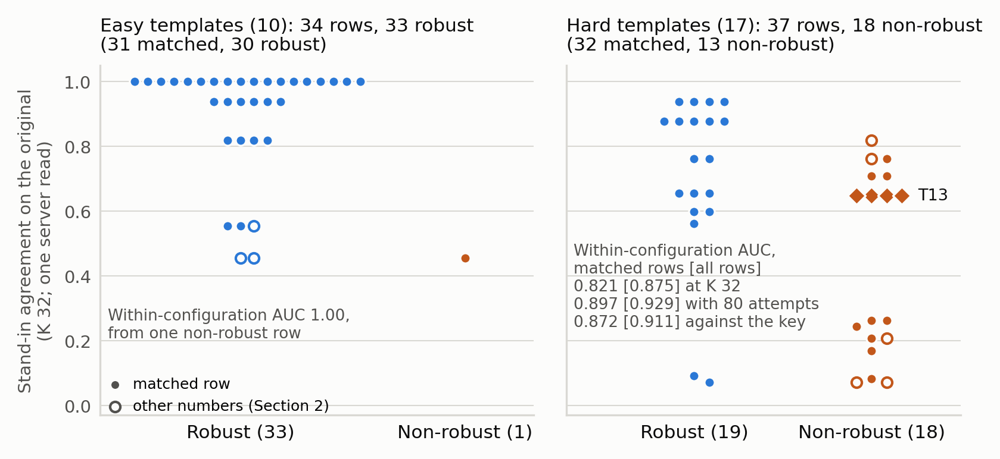

# Answer agreement measures difficulty, not fragility: a robustness predictor and its self-audit

Jude Wallis (Independent researcher)

*Technical report, AIMO Interpretability Challenge 2026 (NeurIPS 2026, Codabench 16180), 22 October 2026 (UTC);
four-page version. Supplementary material: the full report (draft 29, revised 22 October; `report/REPORT_full.pdf` in
the repository), cited as "Supplement X" for its section or appendix X. Hidden cases appear as counts only. Number
labels: board (OFFICIAL validation score), computed (from logs we hold), model-based (simulated or fitted); Appendix A
gives the rest and every number's source.*

## Abstract

The AIMO Interpretability Challenge asks an entry to predict, from a math problem's original text, whether a model's
accuracy survives the organisers' perturbations. We ask what a working robustness predictor actually reads. Ours mostly
reads how often a stronger proxy model's repeated answers agree: on 63 labelled public cases, agreement alone ranks
robust above non-robust cases within each configuration with AUC 0.914, mostly because 30 of 31 cases on easy problems
are robust; on hard problems it is 0.821, and on the same attempts it beats the proxy's answer-key accuracy only within
noise: it measures difficulty. Its errors look problem-level: of 16 problems labelled for several configurations, 15 get
one label from every configuration, against about 9 when labels are shuffled among problems of similar agreement, on 80
cases; harsher perturbation of some problems would do the same. One miss illustrates how: a model's skipped check
changes nothing at the original numbers, so its answer is right there but wrong once our rewrites change them. The
entry, refitted without each problem, is right on 55 of 63 public cases, and on 15 of 21 main and 9 of 14 small cases of
the hidden validation set, against 49, 10 and 7 for always answering robust; exact intervals exclude always robust only
on the main board, barely, and the small track missed our 12.2 prediction. Our self-audit finds that rules kept because
the validation score rose add no demonstrable accuracy, and that the score's rerun standard deviation is about 1.3
cases.

## 1. The question and our answer

The AIMO Interpretability Challenge (Štefánik et al., 2026) labels each pairing of a math problem with a model
configuration as robust or non-robust, by how far its accuracy falls on the organisers' perturbed versions. Seven
configurations are judged: Qwen3.5-4B, Skywork-OR1-Math-7B, Olmo-3-7B-Think and DeepSeek-R1-0528-Qwen3-8B (the small
track) and, on the main track, also gpt-oss-120b at low, medium and high effort. An entry sees only the original
problem, runs each case alone, and in the final meets 30 to 50 new problems at about 170 s per case. Perturbed problems
cut accuracy (Mirzadeh et al., 2025; Huang et al., 2025a; Mondorf et al., 2026); whether interpretations predict unseen
behaviour is asked by Belinkov (2022), Li et al. (2025) and Huang et al. (2025b); agreement among sampled answers is a
known signal of correctness and difficulty (Wang et al., 2023; Kuhn et al., 2023; Farquhar et al., 2024), as is a
model's estimate of what it knows (Kadavath et al., 2022). Our interpretability question is what a working robustness
predictor reads. **Our answer: how hard the problem is (Section 3); what it misses looks like *fragility*, the
problem-level part of the label that agreement does not explain (Section 4), which no reading we tried caught (Section
6).** New here are this split and the audit of our own entry (Section 5).

## 2. Setup

**Data.** We ran one text per template; 8 of the 71 labelled public cases were labelled on different numbers, so we drop
them and keep 63. All our public-case numbers use these 63 (49 robust) unless noted; Appendix A gives every value on all
labelled cases. 22 of the 63, on 12 AIME-2026 templates, are *newer problems*; they are not held out: we saw them while
choosing hand-set values.

**The entry** reads only behaviour on the original. For Qwen, DeepSeek and gpt-oss low and medium cases, the proxy model
(Table 1) makes K attempts (K = 4 to 32, by time left), and a small logistic rule fitted on the labelled public cases
(Supplement F.4) calls the case from their agreement, whether any of 4 non-thinking Qwen3.5-4B attempts ends within
2,000 tokens, and whether the case is gpt-oss medium. For Skywork and Olmo cases it runs the judged model itself (*own
runs*): robust iff at least 1 (Skywork) or 2 (Olmo) of 3 attempts end on their own inside a 9,000- or 10,000-token cap.
gpt-oss high cases are always called robust (Section 5 says why). Time limits: Appendix A.

*Table 1. Terms used throughout.*

| Term | Meaning |
|---|---|
| Case | A (problem, configuration) pair: the unit that is labelled and scored. |
| Template | One public problem: T01 to T28 (T27 has no labelled case). |
| Configuration | One of the seven judged model settings listed in Section 1. |
| Robust / non-robust label | Robust iff the largest accuracy drop over the organisers' families of perturbed texts is at most 0.10; non-robust iff at least 0.25; unlabelled in between. |
| Validation board | The organisers' hidden cases: 21 main (10 robust), 14 small (7 robust). An upload sees only how many it got right, but with our own per-configuration call counts, totals compared across uploads carry some hidden-label information (Supplement A.2). |
| Proxy model | gpt-oss-120b at low effort, run on the original for Qwen, DeepSeek and gpt-oss low and medium cases. |
| Agreement | The chance that two random attempts of the proxy model both end on their own (before the token cap) with the same answer. |
| Hard / easy template | Hard iff Olmo-3-7B-Instruct finished none of 8 attempts within 2,000 tokens: 17 templates (32 cases, 13 non-robust); the other 10 are easy (31 cases, 30 robust). |

## 3. What agreement reads: difficulty

**The test.** If agreement captured more than difficulty, it should clearly beat a pure difficulty score, the proxy's
answer-key accuracy. We score a ranking by its *within-configuration AUC*, the share of same-configuration (robust,
non-robust) case pairs it orders correctly; 95% intervals resample templates. A *read* is one server run of K attempts
on every public problem. On the 17 hard templates (39 pairs), over the same 80 attempts from six reads (K 8 or 16),
agreement beats accuracy only marginally, within noise: 0.897 against 0.872 (difference 0.025, interval 0.000 to 0.176);
swapping accuracy into the entry, refitted leaving each template out, changes 1 of 32 hard-case calls, from wrong to
right. Agreement measures difficulty. The judged model's solve rate predicts little: in a simulation of the organisers'
labelling fitted to public accuracy drops, a case is non-robust with probability 0.18 to 0.21 whether it solved the
original half the time or always (model-based).

**The headline numbers** (post hoc). One read at K = 32, by an earlier build of the entry (which uses 4 to 32 attempts
as time allows), gives agreement AUC 0.914 (0.778 to 0.993) on all 105 pairs: our headline, a score of the agreement
feature, not of the entry (Section 5). Most of it comes from the 10 easy templates, where 30 of 31 cases are robust. On
hard templates this read gives 0.821 (0.448 to 1.000), with 7 of 39 pairs misordered, tying the lowest of the six
smaller reads (0.821 to 0.936). Agreement looks saturated on hard problems; all rest on 39 pairs.

**What agreement cannot see: T10**, a geometry problem summing the possible lengths of a triangle's side, illustrates
how a slip can hide at the given numbers. gpt-oss low agrees with itself more on T10 (0.762) than on the robust T09
(0.655), yet T10 is non-robust for it. On two harsher rewrites of ours, its wrong answers are exactly those of the
correct method minus one check, a lower triangle bound. At the original numbers the check removes nothing (both give
850): the condition is *dormant*, and the slip is an *equivalent mutant*, a changed program with the same output on the
tested input (Papadakis et al., 2015). No answer key, agreement or accuracy at the given numbers can show it; only
numbers on which the condition binds can. The slip was seen in our harsher rewrites only (gpt-oss medium makes it yet is
robust), not shown to cause the organisers' label.

## 4. What agreement misses: the problem's own fragility

Grouped by exact problem text, the labels follow the problem, not the model (computed, post hoc): of the 16 problems
labelled for several configurations, 15 get one label from every configuration, and 4 of the 5 with a non-robust
label are non-robust for all; T10 is the exception. Reading no output of ours, this count uses all 80 labelled
cases, 9 labelled after our design (Appendix A). **Difficulty does not explain it.** In a test we pre-registered, that
is, wrote in our dated records before the result existed (no external timestamp), shuffling each configuration's labels
10,000 times among problems in the same third of agreement gives one label on 9.43 of the 16 on average, never 15 (p ≤
0.0001), and never 4 of 5 all non-robust; on the 71 cases labelled first, 35 shuffles reach 14 of 15 (p = 0.0035). By
our pre-set rule, the claim stands beyond difficulty. A second pre-registered check, adding the other configurations'
labels on the same problem to agreement in a logistic rule (leave-one-template-out), points the same way but is not
significant: AUC rises from 0.882 to 0.976, gain 0.094 (interval −0.037 to 0.286). Caveats: few problems; difficulty finer than a
third of agreement, or unseen by it, counts here as fragility; and if some problems were perturbed harder, labels would
follow the problem too.

## 5. How well the entry generalises

**Against always answering robust** (Table 2). On public cases, each called by a rule refitted without its template
(leave-one-template-out), the entry is right on 55 of 63 (always robust: 49), and on 17 of the 22 newer problems (12).
On the main board it scored 15 of 21 (always robust: 10), inside the predicted range; earlier builds of the same rules
scored 16 and 17. **On the small track the prediction missed**: 9 or 10 of 14 against 12.2 predicted (always robust: 7).
Exact 95% intervals exclude always robust only on the main board, barely (0.478 against 0.476): the small track's 9 of
14 is not distinguishable from always robust's 7 of 14 on its own, nor 55 of 63 (0.765 to 0.944) from 49.

*Table 2. The entry against always robust. Public: leave-one-template-out, one read, template-resampled intervals.
Boards (OFFICIAL): one run each, exact intervals. Predictions: model-based.*

| Cases | The entry (95% interval) | Always robust | Predicted (90% range) |
|---|---|---|---|
| Public, labelled: 63 | 55 (0.873; 0.78 to 0.94) | 49 | — |
| Newer AIME-2026 problems: 22 of the 63, not held out | 17 (0.773; 0.64 to 0.90) | 12 | — |
| Main board: 21 | 15 (0.714; 0.48 to 0.89) | 10 | 17.0 (13 to 20) |
| Small board: 14 | 9 (0.643; 0.35 to 0.87) | 7 | 12.2 (10 to 14), from small-model cases |

**What was fitted, and when.** The logistic rule, the only part fitted to labels, was fitted on 5 October, before the
board-tested changes of 5 to 11 October (Appendix A). About ten hand-set values escape cross-validation. Uploads tested
variants motivated by public cases, never per-case probes, though early ones tested guesses about the hidden sets
(Supplement E.6.2). Three rules tried there decide 8 of 21 main and 6 of 14 small cases. The gpt-oss high constant was
chosen from all public labels (robust 13 times in 15; the logistic rule did worse on its hard cases); the board did not
rise with it. The two own-run rules were kept because the board rose (+3 in all).

**Did board feedback help?** If every changed answer were a coin flip, keeping a change only when the board rises would
still gain +3.9 cases in expectation (90% range 1 to 8); if each were right 70% of the time, +7.3 (3 to 12)
(model-based). The kept +3 lies inside both ranges, so this *selection null* (Dwork et al., 2015; Blum and Hardt, 2015;
Roelofs et al., 2019) cannot tell them apart: **the rules kept because the board rose add no demonstrable accuracy.** We
keep them because dropping them is not better supported: on 9 Skywork cases labelled after the choice, the own run beats
the proxy (8.0 against 7.25 right, averaged over reads), and a pre-registered switch back did not pass.

**Calls are not reproducible across days** (computed). With fixed seeds, same-day reruns match exactly (23 of 23
checks), but in another *server state* (another day), 26% of agreement-based calls flip (90% interval 0.14 to 0.45);
own-run and always-robust calls never did. **This is a reproducibility limit of the entry, and its cause is unknown**
(Appendix A). One board total has a standard deviation of about 1.3 cases on main and 1.0 on small, so a 21-case board
cannot order entries whose readings resample and differ by two cases or fewer. Frozen forecast for the final: Appendix
A.

## 6. What did not work

Of 88 negative results (Supplement D), **70 failed a pre-registered bar**; 2 were unclear, 13 had no bar or a post hoc
one, and 3 were not built or run. Table 3 shows four. A probe of the judged model's internal state reads difficulty, and
Qwen's solve rate in its place loses cases, so **we make no White-Box (internal-signal) claim**. No fragility reading
passed all its bars. Programs that a Claude agent wrote after reading the raters' notes scored 12 of 12 Skywork and Olmo
cases of Table 3's set, blind ones 9 to 11: **a reading computed through a solver's own steps needs a blind
replication.**

*Table 3. Four readings (server: contest server; Mac: 4-bit weights on a Mac). Bars named case sets with the dropped
cases; values on our cases are post hoc; the last row's pre-set repeat was not run.*

| Reading | Measures | Bar, set first | Result | Verdict |
|---|---|---|---|---|
| Qwen3.5-4B prompt-state probe of Qwen's solve rate (Mac) | difficulty | Spearman ≥ 0.40; at most 0.5 cases lost; gain ≥ 2 cases when added | Spearman 0.803; each use loses 0.25 to 3.25 cases; a perfect probe (post hoc) 1.5 to 5.5 | failed |
| Blinded Claude raters: can new numbers make a dormant condition bind? | fragility | AUC ≥ 0.70 on hard cases; then five tries to rate within the time limit, one bar each | 0.646; on our 32 hard cases 0.674, five-rater mean 0.711; no try passed | failed |
| Program check: gpt-oss low's own steps against its brute force on new numbers | fragility | ≥ 11 of 12 Skywork and Olmo cases, two overall counts; AUC ≥ 0.80; Spearman ≥ 0.40 | three blind writers: 9, 11, 10 of 12; AUC 0.724, 0.900, 0.789; Spearman 0.370, 0.303, 0.538 | each failed a bar |
| Answer-keeping organiser-style rewrites, gpt-oss low (server, 7 cases) | fragility | pass: drop ≥ 0.20 on both non-robust cases; fail: < 0.10 on both | +0.03, +0.10: the fail line missed by one hundredth; AUC 0.30 | pass bar missed; unclear |

*"Failed" means not shown: 80% power needs a true Spearman of about 0.51 or an AUC of about 0.77.*

## 7. Lessons

Check labelled texts against the texts you read. Split a predictor's score by where labels vary, and test problem-level
claims with a difficulty-keeping null. Refit label-fitted parts leaving one template out, and compare validation gains
with a selection null. For benchmark builders: only numbers on which a dormant condition binds can tell a method from
its equivalent mutant.

## 8. Limitations

Reading noise rests on 3 server states; the newer problems are not held out; the own-run rules rest on thin, post hoc
support (3 Skywork and 9 Olmo cases when chosen); the raters, whose rubric a Claude agent wrote after seeing the labels,
and the blind writers are Claude subagents; pre-registration has no outside timestamp; the final is rehearsed on a mock,
not run.

## AI Use Statement

**Generative AI was used for most of this work.** We used Anthropic's Claude through Claude Code, a tool in which Claude
writes and runs code, reads and edits files and starts further Claude instances (subagents). The Claude models used were Claude Opus 5.5, Claude Opus 5 and Claude Fable 5.1. Claude was used for:

- **ideation**: research directions, hypotheses and the design of each pre-registered test (bars, controls, outcome
  branches);
- **coding**: the entries, decode paths, mocks, fault injection, the analysis and audit scripts, the release folders and
  the figure scripts; Claude also created and updated the public GitHub repository under the author's account, with the
  author's permission [632, 634];
- **research data**: Claude agents wrote the perturbed problem texts (1,976 texts) [302], the LATENT rating rubric
  [447, 480] and the solution programs of Section 6 [482];
- **experiments and analysis**: local runs, the statistics and the research ledger; Claude also operated the
  competition site in the author's logged-in browser session, to read server logs and, from 5 October, to upload
  entries and research runs, among them v95 and v96 [469] and the evaluated v115 and v116 [574], under permissions the
  author gave in chat (at first for one night [125], later for a session or a named file [239, 503], and standing from
  18 October [556, 601]). One upload went up under a standing go-ahead before the author had answered a question about
  it [288], and one file was uploaded twice by mistake [295];
- **literature**: search and reading (statuses in the References);
- **writing**: this report, its supplement and its consistency checks; Claude instances also reviewed drafts and code.

Claude instances were also the five blinded raters and the three blind program writers of Section 6 (a limitation;
Section 8). No Claude model runs inside the entries, which use only the open models of Section 1.

**Tasks done without generative AI.** The author set the goals and limits of the work; gave the permissions for uploads and compute in chat, mostly as standing permissions; provided the competition, GitHub and other accounts; sent this project's messages to the organisers (Claude drafted some and sent none); made the final decisions, including which entries are evaluated with this paper (Claude recommended them); and submits this report.

**Review and responsibility.** The author reviewed all AI-assisted work and takes full responsibility for the final content of this paper, including AI-assisted text, claims, code and other artefacts.

## References

Status: *read* (we read the paper), *abstract* (abstract page only), *listed* (details from the organisers' proposal's
bibliography; we did not open the work), *record* (authors and venue checked in the publisher's record; abstract not
seen).

- Belinkov (2022). Probing classifiers: promises, shortcomings, and advances. Computational Linguistics 48(1). *Listed*.
- Blum and Hardt (2015). The Ladder: a reliable leaderboard for machine learning competitions. ICML 2015. *Abstract*.
- Dwork et al. (2015). The reusable holdout: preserving validity in adaptive data analysis. Science. *Abstract*.
- Farquhar, Kossen, Kuhn and Gal (2024). Detecting hallucinations in large language models using semantic entropy.
  Nature 630, 625-630. *Record*.
- Huang et al. (2025a). MATH-Perturb: benchmarking LLMs' math reasoning abilities against hard perturbations. ICML 2025;
  arXiv 2502.06453. *Abstract*.
- Huang, Tao, Icard, Yang and Potts (2025b). Internal causal mechanisms robustly predict language model
  out-of-distribution behaviors. ICML 2025. *Listed*.
- Kadavath et al. (2022). Language models (mostly) know what they know. arXiv 2207.05221. *Record*.
- Kuhn, Gal and Farquhar (2023). Semantic uncertainty: linguistic invariances for uncertainty estimation in natural
  language generation. ICLR 2023; arXiv 2302.09664. *Record*.
- Li, Kaufmann, Wattenberg, Alvarez-Melis and Saphra (2025). Can interpretation predict behavior on unseen data? arXiv
  2507.06445. *Listed*.
- Mirzadeh et al. (2025). GSM-Symbolic: understanding the limitations of mathematical reasoning in large language
  models. ICLR 2025. *Listed*.
- Mondorf, Bell, Dodge and Hupkes (2026). LPDS: evaluating LLM robustness through logic-preserving difficulty scaling.
  arXiv 2605.15393. *Read*.
- Papadakis et al. (2015). Trivial compiler equivalence: a large scale empirical study of a simple, fast and effective
  equivalent mutant detection technique. ICSE 2015. *Record*.
- Roelofs et al. (2019). A meta-analysis of overfitting in machine learning. NeurIPS 2019. *Abstract*.
- Štefánik, Mondorf, Waldis et al. (2026). AIMO Interpretability Challenge (the organisers' proposal). arXiv 2607.13899.
  *Read*.
- Wang, Wei, Schuurmans, Le, Chi, Narang, Chowdhery and Zhou (2023). Self-consistency improves chain of thought
  reasoning in language models. ICLR 2023; arXiv 2203.11171. *Record*.

## Appendix A. Supplementary material and reproducibility details

**Reproducibility.** v111, v112, v115, v116, v121 and v122 rebuild byte for byte from the repository's root folder (v115
/ v116 and v121 / v122 from its folders `v115_v116/` and `v121_v122/`; md5s below; every command in its README).
**Training data**: `training/build_calib.py` rebuilds `calib.json` from the organisers' public parquet (Hugging Face
`aimo-interp/train-main-v2`, revision `23791d9b`), and `training/refit_low16.py` refits `decision.json` from it and our
four public-template server logs (`training/runs/`). **Board scores**: each zip runs unchanged in the organisers'
per-case harness; a rerun in another server state varies with a
standard deviation of about 1.3 cases on main and 1.0 on small (Section 5).
**Licence**: code under the MIT License; report text under CC BY 4.0. **Repository**:
https://github.com/EconLearn/aimo-interp-difficulty-vs-fragility.

**Matched cases.** A labelled case is matched, and kept, when its own problem text is the template text all our readings
used; `calib.json` flags this per case (`own_text`, from `build_calib.py`), and a hash of the texts in the organisers'
file gives the same 8 of 71 unmatched cases (9 of 80 once the 9 cases labelled on 15 October are added). Figure 1's
script and `report/figures/recompute_matched_v32.py` compute every matched-case number from the same held logs. The
table below gives the all-case value of each such number in the abstract and Sections 3 and 5 (computed, post hoc, one
server read unless stated; LOTO: leave-one-template-out). Each always-robust value is its case set's robust share in the
organisers' labels. Section 4's label counts read no output of ours, so they group every labelled case under its own
text, the 9 later ones included: 15 of 16 problems and 4 of 5 (14 of 15 and 3 of 4 on the 71). Section 4's
difficulty-preserving test (`samelabel_difficulty.py`, 10,000 shuffles, seed 20261022; its pre-registration has md5
`f1df21c8fc9961e443536e2ccd978565`, recorded before computing) shuffles within configuration and agreement tertile (cut
at 0.456 and 0.781 over the 33 problems): one label on 9.43 of 16 on average, never 15; on the 71, 10.30 of 15, and 35
shuffles reach 14 (all non-robust: 29 reach 3 of 4, p = 0.0029). Information only: on the 63 matched cases p is 0.0014; with
2, 4 or 5 agreement bins p is at most 0.0036 on the 80 and the 71, but on the 63 it is 0.1707 with 5 bins; tertiles of key-scored
accuracy give 0.0023 (80) and 0.0165 (71). The second check uses the 63 cases of the 16 multi-configuration problems
(not the 63 matched cases); its accuracy, not its pre-registered measure, is 62 of 63 against 48 of 63 for agreement
alone (gain 0.222, 95% interval 0.062 to 0.451); on the 71 its AUC gain is 0.018 (−0.260 to 0.222). An earlier shuffle that ignored difficulty (`perm_samelabel.py`,
pre-registration `6afb3e0fdfa4ea7af5f455d24deb463d`) gave 5.88 of 16. A label-peeking oracle, calling a case non-robust
when the other configurations' mean drop on the same text is at least 0.175, would fix 6.4 of the entry's calls per read
and break 0.4 (on the 71 matched cases of those 80, against the calls of a LOTO refit on them, 8 reads; 7.12 fixes on
all 80). The logistic rule was fitted on all labelled public cases, the 8 dropped ones included, after uploads began (2
October); refitting it without the 8 changes no call on the K 32 read (0 or 1 on seven other reads).

| Quantity | Matched cases | All cases |
|---|---|---|
| Within-configuration AUC of agreement, K 32 (cases, non-robust cases, pairs) | 0.914 (63, 14, 105) | 0.929 (71, 19, 155) |
| The same on hard templates | 0.821 (32, 13, 39) | 0.875 (37, 18, 56) |
| Misordered same-configuration pairs, hard templates | 7 of 39 | 7 of 56 |
| Hard templates: 80 pooled attempts; key-scored accuracy | 0.897; 0.872 | 0.929; 0.911 |
| Hard templates: single reads of 8 or 16 attempts | 0.821 to 0.936 | 0.875 to 0.955 |
| Robust cases on easy templates | 30 of 31 | 33 of 34 |
| LOTO: hard cases the key fixes | 1 of 32 | 2 of 37 |
| LOTO: the entry right, labelled cases; newer problems | 55 of 63; 17 of 22 | 60 of 71; 18 of 24 |
| Always robust, labelled cases; newer problems | 49 of 63; 12 of 22 | 52 of 71; 13 of 24 |
| LOTO, small-model cases at the board's class mix; predicted small board | 0.872; 12.2 (10 to 14) | 0.817; 11.4 (8 to 14) |
| LOTO over 8 reads, the 80 cases with the 9 labelled later (pre-registered) | 62.5 of 71 = 0.880 (60 to 64 per read; balanced 0.817); always robust 0.789 | 68.75 of 80 = 0.859; always robust 0.738 |

**Intervals** (`intervals_v37.py`, fixed in the same pre-registration). Template bootstrap (10,000 resamples, seed
20261022) on the 63 matched cases, whose 32 hard cases lie on 15 of the 17 hard templates: 0.914, 0.778 to 0.993; 0.821,
0.448 to 1.000; 0.897, 0.636 to 1.000; 0.872, 0.579 to 1.000; their difference 0.025, 0.000 to 0.176 (0 or less in 59%
of resamples). Exact (Clopper-Pearson) 95% intervals: 15 of 21, 0.478 to 0.887 (always robust 0.476); 9 of 14, 0.351 to
0.872 (0.500); 55 of 63, 0.765 to 0.944 (0.778).

*Figure 1. The proxy model's agreement (the axis says "stand-in", our earlier name for the proxy model) on each labelled
public case, by label, on easy and hard templates (one server read, K 32). Hollow: the 8 dropped cases. Diamonds: T13. Panel titles count all cases, with the
matched ones in parentheses; values in square brackets are all-case values.*

**Evaluated entries.** The entries evaluated with this paper are Codabench 1003729 (v115, main) and 1003727 (v116,
small); by the rule fixed before any final result, the frozen ranges apply to them if they alone are scored. Their
7,200-token Olmo cap costs about 0.6 to 0.9 main and 1.3 to 2.1 small cases per 40 new problems against v111 and v112
(model-based). These ids may still change after the organisers' answers (v111 and v112 if 170 s is an average) or a
pending server timing test of an Olmo variant. The earlier builds of Table 2 are v95 (main, Codabench 991447; 16 of 21)
and v96 (small, 991452; 10 of 14), the first per-case builds of the same rules, and v111 and v112 (17 of 21 and 9 of
14), from which v115 and v116 were made by changing time and token limits only: to end every case within 170 s, own runs
stop at 160 s and Olmo's cap falls to 7,200 tokens, and no validation case took over 148 s. Our decode paths, sharing
key/value reads across query heads, take 0.42x (Skywork) and 0.48x (Olmo) of the default time in server benches
(Supplement E.3). Across the 3 server states of Section 5, the only visible difference was a start-up check of the fast
decode path (failed in one, passed in two). The other rows are listed for reproducibility (md5 of each zip; board
OFFICIAL, one run each, with its Codabench submission id).

| Role | File | md5 | Board |
|---|---|---|---|
| The entry rebuilt for the final, main; small | `aimo_v111_main.zip`; `aimo_v112_small.zip` | `9686c9cec06ec4dc40f9b728f7ef17db`; `8b404890d71bc5483ccce18f88887636` | 17 of 21 (1000991); 9 of 14 (1000212) |
| Per-case-safe variants (own runs stop at 160 s; Olmo cap 7,200 tokens) | `aimo_v115_main.zip`; `aimo_v116_small.zip` | `ad191e2e2262b0a918ec1aaf83bcf9c7`; `d3ada3a4b8ff05b5876582246008bbf9` | 15 of 21 (1003729); 9 of 14 (1003727) |
| The same with every reading's seed shifted | `aimo_v121_main.zip`; `aimo_v122_small.zip` | `22ced3169a4d73b5cfe9b7ceb0d815b6`; `4de6852eee8d4c3e6ccb07576c422a31` | 15 of 21 (1004377); 9 of 14 (1004381) |

**The forecast** (Section 5). We expect v111 (v115's parent: same rules, looser limits) to get **about 16 of 21 main
cases right on new problems** (90% range 11 to 20), not the 19 of our best board run, v65 (Codabench 976461; other draws
of its recipe scored 16 to 18). Guess ranges for final accuracy, frozen on 17 October, are 0.72 to 0.82 for v111 and
0.62 to 0.76 for v112. On 30 to 50 new problems, reading noise (Section 5) and problem sampling give an accuracy
standard deviation of about 0.07 to 0.09 per run; that noise alone would put the final inside them only about 40 to 50%
(v111) and 55 to 70% (v112) of the time (computed), so a hit is weak support; a miss by more than about 0.08 would count
against us. The assumptions, the hash and the rule that applies the ranges to the evaluated v115 and v116 follow.

**Frozen prediction** (Section 5). Assumed: a roughly balanced class mix, a validation-like configuration mix and a
server at most 1.2x slower than our mock, with 170 s as an average (a per-case limit leaves v111 15 of 21 answered). By
a rule fixed before any final result, the forecast holds on a track if the final accuracy of v111 (main) or v112
(small), or of another nominee if only that one is scored, lies in its range, so the ranges apply to v115 and v116 if
they alone are scored. The prediction's ledger row (`work/miners18/FROZEN_PREDICTION_ledger543.txt`) has sha256
`ffd7c3fcc370631dbc7501bd713444df47f067ede871a672c15ead8aa91a2ec6`, computed on 18 October after the board runs of that
day, with no external timestamp. **Outcome.** The final had not been scored when this report was submitted; we will
report the evaluated entries' accuracy against the frozen ranges, whichever way it falls.

**Supplementary material.** The full report (draft 29, revised 22 October, 39 pages; `report/REPORT_full.pdf` in the
repository) holds every detail this version omits; its supplement folder `report/report_supplement/` holds the full
text of its longer appendix parts. Where to look: the audit in full, Supplement E.13, and the board draws against it, the
supplement's Figure 1; every board upload, Supplement A; board-feedback use, Supplement A.2; the 88 negative results
with their bars, Supplement D and E.6; the worked T10 example, Supplement E.12; decode paths, Supplement E.3; the
final-shape mocks and the pre-mortem, Supplement E.15 and E.17; token confidence, the 80-row rescore, the key-headroom
check and the fragility vectors, Supplement E.18; the decision rule's coefficients, Supplement F.4; scripts, including
`audit.py`, Supplement F.7. Figure 1 is made by `report/figures/make_agreement_by_label_v32.py` from held logs (lane G's
loader and the server read of 15 October); it writes its numbers to `report/figures/make_agreement_by_label_v32.out`.
The supplement calls the proxy model the stand-in, the newer problems fresh rows and the matched cases matched rows.

**Number labels.** *Board*: the OFFICIAL hidden validation score, counts only, one run each. *Public cases*: the
labelled public cases (in-sample where our rule was fitted on them). *Server*: a research run on the contest server.
*Computed*: offline, from logs or outputs we hold. *Mock*: a rehearsal on a virtual clock (time, coverage and validity,
not accuracy). *Model-based*: a simulation or a fitted model. *Mac* (the supplement's local proxy): a run on a Mac with
4-bit weights standing in for a judged model. *Guess*: a judgement, given as a range.

**Ledger entries.** The numbers of each section come from these entries of our dated research ledger (the supplement
cites them at each number, except 589 and 627, release rebuild checks, and 656, which came after it); in this Markdown
version the AI Use Statement also cites them in square brackets, which hold nothing else. The ledger holds internal
notes and is not published as it stands; a redacted extract of the cited entries is available on request. Section 4's
tests and the intervals are not ledger entries; their scripts and pre-registrations are named under Matched cases and
Intervals.

Section 1: 2, 178, 464, 513, 537; Section 2: 3, 278, 382, 617, 618, 446, 509, 661, 664, 99, 270, 266, 282, 290, 329b,
272b, 267b, 269, 339, 336, 573, 575, 576, 360, 186, 365; Section 3: 416, 197, 266, 611, 440, 267b, 278, 664, 446, 318;
Section 4: 664, 611, 440, 278; Section 5: 113, 20, 509, 471, 560, 564, 575, 576, 573, 664, 618, 336, 338, 350, 585,
393, 543, 656; Section 6: 652, 499, 506, 516, 555, 447, 457, 461, 470, 477, 479, 491, 664, 521, 523, 528, 619, 302, 309,
480, 482, 489; Section 7: 585, 509, 446; Section 8: 585, 339, 387, 447, 480, 538; AI Use Statement: 632, 634, 302, 447,
480, 482, 469, 574, 125, 239, 503, 556, 601, 288, 295; Appendix A: 549, 589, 627, 585, 661, 664, 611, 440, 446, 318,
574, 568, 654, 657, 663, 469, 471, 540, 560, 564, 573, 575, 576, 588, 608, 566, 543, 393, 350.
