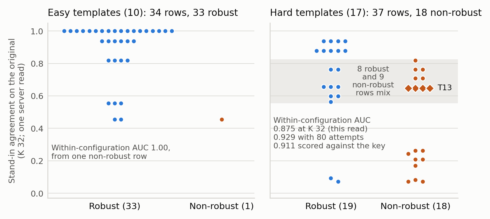

# Difficulty is not fragility: an audited robustness predictor and 70 negative results

Jude Wallis (Independent researcher)

*Technical report, AIMO Interpretability Challenge 2026 (NeurIPS 2026, Codabench 16180), 20 October 2026 (UTC); four-page
version (draft 30). The full report (draft 29, `report/REPORT_full.pdf` in the repository) is its supplementary material: "Supplement X" points to
its section or appendix X. Numbers come from our research ledger (entry in brackets) or Figure 1's script; hidden cases
appear as counts only. Number labels are defined in Appendix A.*

## Abstract

We predict, inside a fixed GPU budget, whether a configuration's accuracy on a math problem survives the organisers'
perturbations, and find that difficulty is not fragility. A stronger model's answer agreement reads a problem's
difficulty and ranks the 71 labelled public rows at within-configuration AUC 0.929, mostly because 33 of 34 rows on
easy templates are robust. On the 37 rows of hard templates the AUC is 0.875, robust and non-robust rows mix at the
same agreement, and 2.5 times more attempts or a perfect answer key add at most 0.054 AUC and 2 rows. What is left is
fragility, and no in-budget attempt to read it passed a bar set before its data: of 88 negative results, 70 failed and
2 were unclear. Leave-one-template-out our entry gets 60 of 71 public and 18 of 24 fresh rows, its board-chosen layer
gained no more than keep-if-better selection on coin flips, and a 21-case validation board total varies by about 1.3
cases across server states.

## 1. Introduction

The AIMO Interpretability Challenge (Štefánik et al., 2026) asks, for each *case*, a (problem, configuration) pair,
whether the configuration's accuracy survives perturbation of the problem. The configurations are Qwen3.5-4B,
Skywork-OR1-Math-7B, Olmo-3-7B-Think and DeepSeek-R1-0528-Qwen3-8B (the small track), and gpt-oss-120b at low, medium
and high effort. A case is robust iff the largest accuracy drop over the organisers' families of perturbed texts is at
most 0.10, non-robust iff at least 0.25, and exists only if the configuration solves the original robustly [2]. An entry
sees only the original text, runs each case in its own process on one GPU [178, 464] and faces 30 to 50 new problems in
the final at about 170 s each [513, 537].

We show that **difficulty is not fragility**: a stronger model's reading of difficulty carries most of the public
ranking but saturates on hard problems, where the label turns on fragility and none of our in-budget readings passed a
pre-set bar (Sections 3 and 6). Edited or re-instantiated problems are known to cut accuracy (Mirzadeh et al., 2025;
Huang et al., 2025a; Mondorf et al., 2026); whether probes and interpretations predict unseen behaviour is asked by
Belinkov (2022), Li et al. (2025) and Huang et al. (2025b). We ask it of a whole entry, with a selection null from
adaptive data analysis (Dwork et al., 2015; Blum and Hardt, 2015; Roelofs et al., 2019).

## 2. Data and the entry

**Data.** 82 public rows over 28 templates, 71 labelled (52 robust) [3, 278, 382]; *fresh rows* are the 24 labelled rows
on 12 AIME-2026 templates [446, 509]; 9 of 12 Skywork rows added on 15 October are labelled (7 robust) [617]. The
validation boards hold 21 main cases (10 robust) [99] and 14 small cases (7 robust) [270]. The site invites iterating
on them; when we did, each upload was a method variant with a public-row reason, never constant answers per
configuration or per-case probes, but board counts per configuration carry hidden-label information [329b], which we
used while choosing three routes (Supplement A.2); Section 4 audits that use.

**The entry reads behaviour only.** *Stand-in* (Qwen, DeepSeek, gpt-oss low and medium cases): gpt-oss-120b at low
effort makes 4 to 32 attempts; their *agreement* (the probability that two attempts that ended on their own agree), a
Qwen3.5-4B quick finish and an effort code enter a logistic rule with 10 coefficients (`decision.json`) [272b]. *Own
runs* (Skywork, Olmo): robust iff at least 1 (Skywork) or 2 (Olmo) of 3 attempts of the judged model end on their own
inside a 9,000- or 10,000-token cap [269, 339]. *Prior* (gpt-oss high): robust, as 13 of 15 public rows are [336]. *The
entry* is v95 (main) and v96 (small); v111 and v112 are their rebuilds for the final [540].

## 3. Difficulty is not fragility

**Two meanings of difficulty.** The judged model's solve rate carries almost none of the label: in our fit of the
label recipe the chance of a non-robust label is flat, 0.18 to 0.21, for solve rates from 0.5 to 1.0, and sampling
noise explains only about 3% of non-robust labels (computed) [416]; on T13 every small model solves the problem and
every one is labelled non-robust [197, 266]. Difficulty read by a stronger model carries far more: within each
configuration, the stand-in's agreement at K 32 ranks the 71 public rows at AUC 0.929 [611].

**That reading saturates on hard templates** (Figure 1; computed, post hoc, one server read [440]). Its AUC comes
mostly from the 10 easy templates, where 33 of 34 rows are robust. On the 17 *hard* templates, which a 2,000-token
reader never finishes (37 rows, 18 non-robust) [267b, 278], it is 0.875, and between agreement 0.56 and 0.82, 8 robust
and 9 non-robust rows mix. 80 pooled attempts give 0.929 and their accuracy against the answer key 0.911, inside the
0.875 to 0.955 of single held reads; leave-one-template-out (LOTO), the key fixes 2 hard rows [611]. Decisions built on
agreement get 0.743 of hard rows right (LOTO accuracy, mean of six reads) [278]; 7 of our entry's 11 LOTO errors are
hard rows.

*Figure 1. The stand-in's agreement on each labelled public row (one server read, K 32), by label, on easy and hard
templates. Diamonds: T13. Shading: the range where both labels occur. Script `figures/make_agreement_by_label_v30.py`.*

**What fragility can look like.** On two harsher expert-style T10 texts, gpt-oss low's wrong answers are exactly those
of a mutant of the correct method that skips a triangle bound, equivalent at the original numbers (850 = 850; Papadakis
et al., 2015) [446]. gpt-oss medium shares the slip yet is labelled robust, so our texts are harsher than the
organisers' [318].

## 4. A generalisation audit

**What was fitted, and when.** The only label-fitted part, `decision.json`, was fitted on the 71 public rows on 5
October, before the board-iteration period of 10 to 11 October; a LOTO refit changes 1 of 71 answers [509]. Three
choices from that period (the gpt-oss high prior and both own runs) decide 8 of 21 main and 6 of 14 small cases; about
ten hand-set values (caps, K, thresholds) cannot be cross-validated. Table 1 gives out-of-sample accuracy.

*Table 1. The entry's rules on public rows (same server read), LOTO with `decision.json` refitted per held-out
template (template-bootstrap 95% intervals; the 80-row line pre-registered [618]), the board this predicts
(model-based) and the board observed (OFFICIAL, one draw each) [471, 560, 564].*

| Rows, LOTO | Accuracy | Predicted board (90% range) | Board |
|---|---|---|---|
| All 71 (in-sample 61) [509] | 60/71 = 0.845 [0.75, 0.92] | main 17.0 (13 to 20) | 16 (v95), 17 (v111) |
| 24 fresh AIME-2026 rows [509] | 18/24 = 0.750 [0.59, 0.91] | main 15.7 (11 to 20) | 16, 17 |
| 34 small-model rows [509] | 0.817 at the board's class mix | small 11.4 (8 to 14) | 10 (v96), 9 (v112) |
| 80 rows, 8 reads pooled [618] | 68.75/80 = 0.859 (65 to 71 per read; balanced 0.826; always-robust 0.738) | — | — |

**The board-chosen layer against a selection null.** Keeping a change only when the board rises gains +3.9 in
expectation (90% range 1 to 8) if every changed answer is a coin flip and +7.3 (3 to 12) if each is right 70% of the
time (model-based). The three routes kept +3, inferred from board counts (Supplement A.2) [509], inside both ranges:
the test cannot separate them, and **the board-chosen layer adds no demonstrable accuracy**. Moving Skywork's cases to
the stand-in gains on the original public rows in four of five reads, and three of the six LOTO fresh-row errors sit on
board-chosen routes [509]. On 9 Skywork rows labelled later (7 robust), the own run gets 9 of 9 on one read but 7, the
always-robust count, on another, and the stand-in about 7.3 over eight reads [617, 618], so they cannot separate the routes.

**A frozen prediction.** We expect v111 to get **about 16 of 21 main cases right on new problems** (90% range 11 to 20),
not our best draw's 19 [393, 509]. Guess ranges for final accuracy, frozen on 17 October [543] (assumptions, rule and
hash in Appendix A), are 0.72 to 0.82 for v111 and 0.62 to 0.76 for v112; Section 5's noise alone gives them only about
0.4 to 0.5 and 0.55 to 0.7 coverage (computed). **Outcome.** The final is scored after this report's deadline, so the outcome is not known at submission; we will report each nominee's accuracy against these ranges, read with the coverage note, whichever way it falls.

## 5. How much a board score moves

From our own logs, without hidden labels (computed) [585]: a reading repeats exactly within one server state (23 of 23
same-problem groups), but across states a stand-in call flips with probability about 0.26 (90% interval 0.14 to 0.45;
12 flips in 46 comparisons). One board total thus varies by about 1.3 cases on main and 1.0 on small, matching four
earlier draws of the same rules (19, 17, 18, 16) [393]. **A 21-case board cannot order entries whose readings resample and
that differ by two cases or fewer**: 17 against 15 arises with probability 0.41 with no real difference. On 30 to 50 new
problems, reading noise and problem sampling give about 0.07 to 0.09 accuracy per run.

## 6. Negative results

Of 88 negative results (Supplement D), **70 failed a bar written before their data** in our dated, author-controlled
ledger (no external timestamp), 2 were unclear (Supplement D, judging substance, counts Table 2's last row as failed),
13 had no bar or a post hoc one, and 3 were not built or run; some are engineering levers or board bets. In Table 2, a
difficulty variant adds nothing over agreement and no fragility reading passed.

*Table 2. Seven informative readings (server: contest server; local proxy: 4-bit weights on a Mac). Ledger by row:
[394], [499, 506, 516, 555], [614], [447, 457, 461, 470, 477, 479, 491], [521, 523, 528], [619], [302, 309].*

| Reading | Measures | Bar, set first | Result | Verdict |
|---|---|---|---|---|
| Probe on Qwen3.5-4B prompt states (server) | internal state | balanced accuracy ≥ 0.80 | 0.669 (stand-in 0.844) | failed |
| Probes for the rating below: Qwen3.5-4B states on text, solution, thinking (local proxy); gpt-oss-120b (server) | internal state | Spearman ≥ 0.60, 28 templates | 0.277, 0.454, 0.304; 0.030 | failed |
| Token confidence for agreement, four forms (Fu et al., 2025; server) | difficulty | +2 rows of 71; +1 on a second read | −3, 0, −12, −9; second read −1, 0, −7, −3 | failed |
| Five blinded Claude raters: would new numbers make a dormant condition bind? Five in-hour versions | fragility | AUC ≥ 0.70, 37 hard rows; one bar per version | 0.646; none of five passed | failed |
| STD: own steps against own brute force on new numbers; three blind writers | fragility | 11 of 12 7B rows; AUC ≥ 0.80; Spearman ≥ 0.40 | 9, 11, 10 of 12; AUC 0.724, 0.900, 0.789 | each failed a bar |
| Premise reliance; instance-binding depth (local proxy) | fragility | Spearman with the rating ≤ −0.30; sabotage loses | +0.150 (11 of 34 problems defined); −0.038 (27); sabotage did not lose | failed |
| Answer-keeping organiser-style rewrites, gpt-oss low (server, 7 rows) | fragility | drop ≥ 0.20 on non-robust rows | +0.03, +0.10; AUC 0.30 | unclear (0.10 is the boundary) |

*At these sizes 80% power needs a true Spearman of about 0.51 (28 templates) or an AUC of about 0.77 (19 against 18
rows) (Supplement D): "failed" means not shown, not absent. One read of the 80-row bench scores 65 to 71 [618], so +1-
and +2-row gates sit within read-to-read spread [616].*

**Probes** held signal inside their 325-problem training pool (nested Spearman 0.346) that did not transfer to the 28
templates [499, 516]: **we make no White-Box claim**. **STD**, written by an author who had read the raters' notes,
scored 12 of 12 7B rows, blind 9 to 11 [489]: **a reading computed through a solver's own steps needs a blind
replication.**

## 7. Efficiency under a 170 s per-case budget

For the per-case harness of 15 October the entry rebuilt the work per case [464, 468, 471, 476]. Our decode paths
share one K/V read across a KV head's query heads and write K and V in place [360, 186]; in pre-registered server
benches a step takes 0.42x (Skywork) and 0.48x (Olmo) of the default time, gpt-oss-120b 54.9 against 225.2 ms [365,
193]. Per-case-safe variants (v115, v116) answered every board case in at most 148 s, under the final's 170 s [575,
576].

## 8. Limitations and lessons

**Limitations.** Reading noise is measured coarsely (3 server states) [585]; fresh rows were seen while hand-set values
were chosen; the own runs rest on thin, post hoc support (3 Skywork and 9 Olmo rows when chosen) [339, 387]; the rating
rubric's author had seen the labels [447, 453]; raters and blind writers are Claude subagents; the final is mocked, not
run [538]. **Lessons.** Split a reading's score by where the label varies; refit label-fitted parts LOTO and compare board gains
with a selection null (`audit.py`), which moved our expectation from our best draw (19) to about 16 of 21; set bars
above read-to-read noise.

## AI Use Statement

**Generative AI was used for most of this work.** We used Anthropic's Claude through Claude Code, a tool in which Claude
writes and runs code, reads and edits files and starts further Claude instances (subagents). The Claude models used were Claude Opus 5.5, Claude Opus 5 and Claude Fable 5.1. Claude was used for:

- **ideation**: research directions, hypotheses and the design of each pre-registered test (bars, controls, outcome
  branches);
- **coding**: the entries, decode paths, mocks, fault injection, the analysis and audit scripts, the release folders and
  the figure scripts;
- **experiments and analysis**: local runs, the statistics and the research ledger; operating the competition site in a
  logged-in browser session of the competition account, to read server logs and, from 18 October, to upload entries
  and research runs [556, 601];
- **literature**: search and reading (statuses in the References);
- **writing**: this report, its supplement and its consistency checks; Claude instances also reviewed drafts and code.

Claude instances were also the five blinded raters and the three blind program writers of Section 6 (a limitation;
Section 8). No Claude model runs inside the entries, which use only the open models of Section 1.

**Tasks done without generative AI.** The author set the goals and limits of the work; authorised every upload, including those Claude carried out from 18 October, and every use of compute; made the final decisions, including the nominations; provided and managed the competition account and all other accounts; sent every message to the organisers (Claude drafted some of them); and submits this report.

**Review and responsibility.** The author reviewed this report and its results before submission and takes full responsibility for the final content of this paper, including AI-assisted text, claims, code and other artefacts.

## References

Status: *read* (we read the paper), *abstract* (abstract page only), *listed* (details from the organisers' proposal's
bibliography; we did not open the work), *record* (authors and venue checked in the publisher's record; abstract not
seen).

- Belinkov (2022). Probing classifiers: promises, shortcomings, and advances. Computational Linguistics 48(1). *Listed*.
- Blum and Hardt (2015). The Ladder: a reliable leaderboard for machine learning competitions. ICML 2015. *Abstract*.
- Dwork et al. (2015). The reusable holdout: preserving validity in adaptive data analysis. Science. *Abstract*.
- Fu, Wang, Tian and Zhao (2025). Deep think with confidence (DeepConf). arXiv 2508.15260. *Abstract* [583].
- Huang et al. (2025a). MATH-Perturb: benchmarking LLMs' math reasoning abilities against hard perturbations. ICML 2025;
  arXiv 2502.06453. *Abstract*.
- Huang, Tao, Icard, Yang and Potts (2025b). Internal causal mechanisms robustly predict language model
  out-of-distribution behaviors. ICML 2025. *Listed*.
- Li, Kaufmann, Wattenberg, Alvarez-Melis and Saphra (2025). Can interpretation predict behavior on unseen data? arXiv
  2507.06445. *Listed*.
- Mirzadeh et al. (2025). GSM-Symbolic: understanding the limitations of mathematical reasoning in large language
  models. ICLR 2025. *Listed*.
- Mondorf, Bell, Dodge and Hupkes (2026). LPDS: evaluating LLM robustness through logic-preserving difficulty scaling.
  arXiv 2605.15393. *Read*.
- Papadakis et al. (2015). Trivial compiler equivalence: a large scale empirical study of a simple, fast and effective
  equivalent mutant detection technique. ICSE 2015. *Record*.
- Roelofs et al. (2019). A meta-analysis of overfitting in machine learning. NeurIPS 2019. *Abstract*.
- Štefánik, Mondorf, Waldis et al. (2026). AIMO Interpretability Challenge (the organisers' proposal). arXiv 2607.13899.
  *Read*.

## Appendix A. Supplementary material and reproducibility details

**Reproducibility.** v111, v112, v115, v116, v121 and v122 rebuild byte for byte from the repository's root folder (v115 /
v116 and v121 / v122 from its folders `v115_v116/` and `v121_v122/`; md5s below; every command in its README) [549, 589,
627]. **Training data**: `training/build_calib.py` rebuilds `calib.json` from the organisers' public parquet (Hugging
Face `aimo-interp/train-main-v2`, revision `23791d9b`), and `training/refit_low16.py` refits `decision.json` from it and
our four public-template server logs (`training/runs/`). **Board scores**: each zip runs unchanged in the organisers'
per-case harness; a rerun in another server state varies by about 1.3 cases on main and 1.0 on small (Section 5) [585].
**Licence**: code under the MIT License; report text under CC BY 4.0. **Repository**: https://github.com/EconLearn/aimo-interp-difficulty-vs-fragility.

**Candidate nominee files** (md5 of each zip; board OFFICIAL, one draw each; the nomination plan is in Supplement 10):

| Role | File | md5 | Board |
|---|---|---|---|
| The entry rebuilt for the final, main; small | `aimo_v111_main.zip`; `aimo_v112_small.zip` | 9686c9cec06ec4dc40f9b728f7ef17db; 8b404890d71bc5483ccce18f88887636 [540] | 17 of 21; 9 of 14 [560, 564] |
| Per-case-safe variants (own runs stop at 160 s) | `aimo_v115_main.zip`; `aimo_v116_small.zip` | ad191e2e2262b0a918ec1aaf83bcf9c7; d3ada3a4b8ff05b5876582246008bbf9 [573] | 15 of 21; 9 of 14 [575, 576] |
| The same with every reading's seed shifted | `aimo_v121_main.zip`; `aimo_v122_small.zip` | 22ced3169a4d73b5cfe9b7ceb0d815b6; 4de6852eee8d4c3e6ccb07576c422a31 [588] | 15 of 21; 9 of 14 [608] |

**Frozen prediction** (Section 4). Assumed: a roughly balanced class mix, a validation-like configuration mix and a
server at most 1.2x slower than our mock. By a rule fixed before any final result [568], the forecast holds on a track
if the final accuracy of v111 (main) or v112 (small), or of another nominee if only that one is scored, lies in its
range. The prediction's ledger row (`work/miners18/FROZEN_PREDICTION_ledger543.txt`) has sha256
`ffd7c3fcc370631dbc7501bd713444df47f067ede871a672c15ead8aa91a2ec6`, computed on 18 October after the board runs of that
day, with no external timestamp [566].

**Supplementary material.** The full report (draft 29, 38 pages; `report/REPORT_full.pdf` and `report/REPORT_full.md` in the
repository) holds every detail this version omits; its supplement folder `report_supplement/` holds the full text of its longer
appendix parts. Where to look: the audit in full, Supplement E.13, and the board draws against it, the supplement's
Figure 1; every board upload, Supplement A; board-feedback use, Supplement A.2; the 88 negative results with their bars,
Supplement D and E.6; the worked T10 example, Supplement E.12; decode paths, Supplement E.3; the final-shape mocks and
the pre-mortem, Supplement E.15 and E.17; token confidence, the 80-row rescore, the key-headroom check and the fragility
vectors, Supplement E.18; the decision rule's coefficients, Supplement F.4; scripts, including `audit.py`, Supplement
F.7. Figure 1 is made by `figures/make_agreement_by_label_v30.py` from held logs (lane G's loader and the server read of
15 October); it writes its numbers to `figures/make_agreement_by_label_v30.out`.

**Number labels.** *Board*: the OFFICIAL hidden validation score, counts only, one draw each. *Public rows*: the
labelled public rows (in-sample where our rule was fitted on them). *Server*: a research run on the contest server.
*Computed*: offline, from logs or outputs we hold. *Mock*: a rehearsal on a virtual clock (time, coverage and validity,
not accuracy). *Model-based*: a simulation. *Local proxy*: a run on a Mac with 4-bit weights standing in for a judged
model. *Guess*: a judgement, given as a range.

**Ledger entries.** Every bracketed number is an entry of our dated research ledger; the full report cites the same
entries. The ledger holds internal notes and is not published as it stands; a redacted extract of the cited entries is
available on request.
